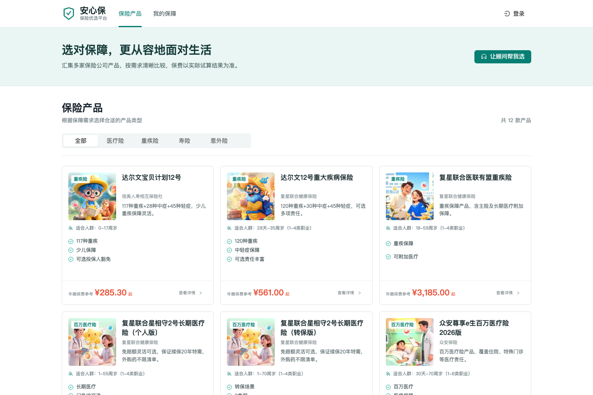
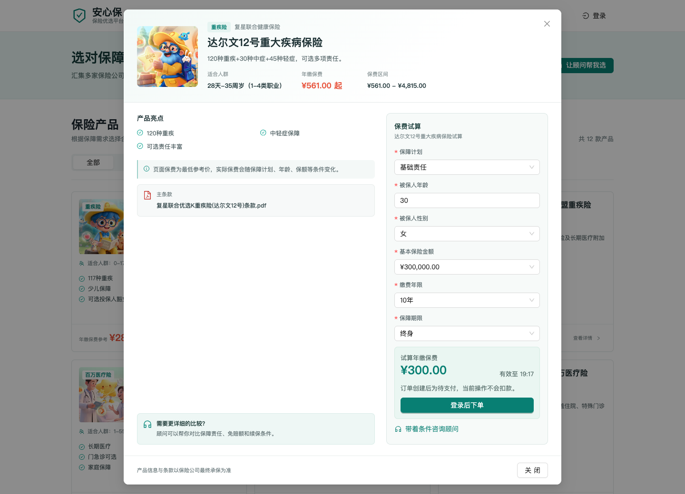
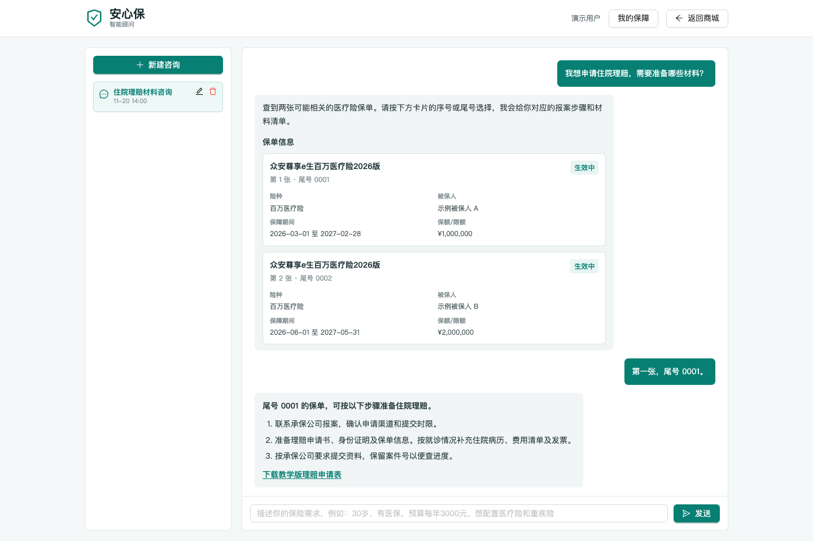
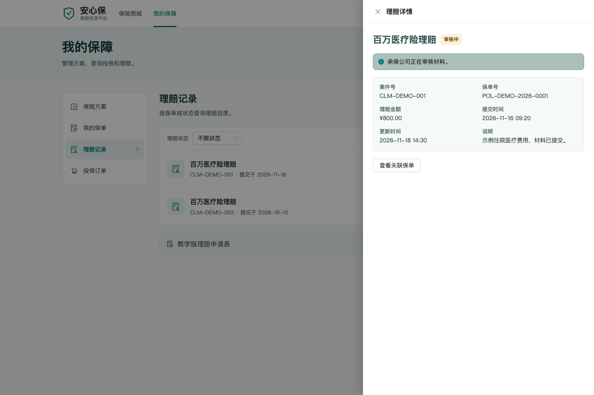

# 安心保

安心保是一个保险商城和智能顾问的教学项目。用户可以浏览保险产品、按保障条件试算保费、保存推荐方案，并在「我的保障」查看保单、理赔记录和投保订单。

## 功能

| 功能 | 可以做什么 |
| --- | --- |
| 保险商城 | 按医疗险、重疾险、寿险和意外险筛选产品，查看产品详情和保障亮点。 |
| 保费试算 | 根据产品模板填写被保人信息和保障条件，获取模拟年缴保费与报价有效期。 |
| 智能顾问 | 根据需求和预算推荐产品，试算指定产品，检索条款并展示原文引用。保存方案需要用户确认。 |
| 理赔助手 | 查询理赔进度，按保单提供报案步骤和材料清单，下载教学版申请表。涉及多张保单时，可按聊天卡片的序号或尾号选择。 |
| 我的保障 | 查看已保存方案、保单、理赔记录和订单，查看详情或取消符合条件的待支付订单。 |

保费试算、订单和保单用于教学演示。实际投保和理赔由承保公司受理。在线人工客服暂未接入。

## 页面截图

截图来自本地运行的页面。试算结果、账号、对话和理赔记录使用示例数据。

### 保险商城



### 产品详情与保费试算



### 理赔助手



### 理赔记录与详情



## 本地运行

在 `hm-insurance` 目录执行以下命令。需要 Docker Compose、Python 3.14、`uv` 和 Node.js 20 或更高版本。

### 1. 启动数据库和向量库

首次运行时复制 Milvus 配置。条款检索使用 DashScope 重排，在副本中填写自己的 `credential.dashscope_apikey.apikey`。 [Milvus 配置说明](deploy/milvus/README.md)

```bash
cp deploy/milvus/user.example.yaml deploy/milvus/user.yaml
docker compose -f deploy/docker-compose.yml up -d postgres milvus
```

Compose 会启动 Milvus 所需的 etcd 和 MinIO。PostgreSQL 初次创建数据卷时，会加载业务表、检查点表和演示产品数据。 [初始化脚本](deploy/postgres/init)

### 2. 启动后端

首次运行时从示例创建 `agent-service/.env`。填写 `DEEPSEEK_API_KEY`，生成独立的 `JWT_SECRET_KEY`（至少 32 个字符），并按本地部署填写 `DB_*`、`MILVUS_*`。构建条款知识库时还需填写 `MINERU_TOKEN`。 [后端环境变量示例](agent-service/.env.example)

```bash
cd agent-service
cp .env.example .env
# 编辑 .env 后再启动
uv sync --locked
uv run --locked uvicorn app.main:app --host 127.0.0.1 --port 8001 --reload
```

服务启动后可访问 [健康检查](http://127.0.0.1:8001/health) 和 [Swagger API 文档](http://127.0.0.1:8001/docs)。

### 3. 启动前端

在另一个终端，从项目目录执行：

```bash
cd frontend
npm ci
npm run dev
```

打开 [安心保](http://localhost:5173)。Vite 默认将 `/api` 请求代理到 `127.0.0.1:8001`。如果后端使用其他地址，可复制前端环境变量示例为 `.env.local`，再修改 `VITE_BACKEND_HOST` 和 `VITE_BACKEND_PORT`。 [前端环境变量示例](frontend/.env.example)

### 4. 构建条款知识库

从空库启动时，先准备提供 `qwen3-embedding:0.6b` 的 Ollama 服务。当前 Ollama 地址写在运行时配置和入库脚本中，将两处都改为可访问的同一地址后，在 `agent-service` 目录执行：

```bash
uv run --locked python scripts/ingest_rag.py
```

脚本将产品条款导入 Milvus 的 `insurance_collection` 集合，供推荐和理赔 Agent 检索。 [运行时配置](agent-service/app/rag/__init__.py) · [入库脚本](agent-service/scripts/ingest_rag.py)

## 项目结构

```text
hm-insurance/
├── frontend/                # React、TypeScript、Ant Design、Vite
├── agent-service/
│   ├── app/agents/          # LangGraph 主图、推荐和理赔 Agent、业务工具
│   ├── app/modules/         # FastAPI 路由、服务与数据库访问
│   ├── app/rag/             # 产品条款入库与检索
│   ├── scripts/             # 知识库构建入口
│   └── tests/               # 后端回归测试
├── deploy/                 # PostgreSQL、Milvus 等基础服务
└── docs/                   # 接口文档、实现分析与页面截图
```

聊天使用 SSE 输出文字和卡片，LangGraph 将会话检查点保存在 PostgreSQL。条款检索使用 Milvus，试算通过产品模板和 Mock 适配器生成报价。 [接口文档](docs/安心保接口文档.md) · [功能实现分析](docs/项目功能实现分析/00-功能分析索引.md)
