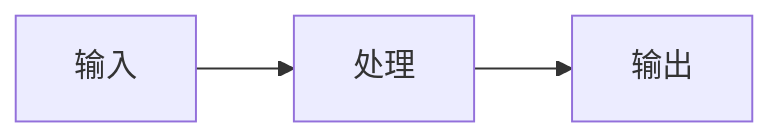

# LangChain 底层问题索引

本目录保存开发过程中对 LangChain / LangGraph 底层机制的学习笔记。一篇笔记聚焦一个主题，主题内可以包含多个相关问答。

| 编号 | 主题 | 详细流程图 | 可编辑图源 |
| --- | --- | --- | --- |
| 01 | [PostgreSQL 检查点的存储与删除](01-PostgreSQL检查点的存储与删除.md) | [Archify 流程图](流程图/01-PostgreSQL检查点的存储与删除.html) | [draw.io](图源/01-PostgreSQL检查点的存储与删除.drawio) |

## 目录约定

```text
LangChain底层问题/
├── 00-问题索引.md
├── 01-PostgreSQL检查点的存储与删除.md
├── 图源/
│   └── 01-PostgreSQL检查点的存储与删除.drawio
└── 流程图/
    ├── 01-PostgreSQL检查点的存储与删除.html
    ├── 01-PostgreSQL检查点的存储与删除.json
    └── 校验资料/（生成与浏览器校验回执）
```

- 笔记按 `01`、`02`、`03` 顺序编号，使用中文主题名称。
- 正文直接嵌入 Mermaid；需要编辑原生图形时使用 `图源/` 中的 draw.io 文件。
- Archify 详细流程图单独放在 `流程图/`，与笔记保持相同文件名，仅扩展名不同。
- JSON 是 Archify 可再生成的规范源；校验回执集中存放，避免混入笔记。
- `校验资料/源码快照.bundle` 保留了图中引用的当前工作区源码与 saver 依赖源码；它是独立的本地 Git 证据快照，没有提交或修改原项目。图中修订号属于这个快照，不能当作远程仓库修订号。
- 流程图描述当前代码，不将建议方案画成已经实现的行为。

## 新笔记模板

````markdown
# 02 主题名称

> 提问日期：YYYY-MM-DD
> 代码 / 依赖版本：

## 我的问题

## 一句话结论

## 结合本项目理解



## 实现细节与边界

## 来源与待验证项

[详细流程图](流程图/02-主题名称.html)
````
