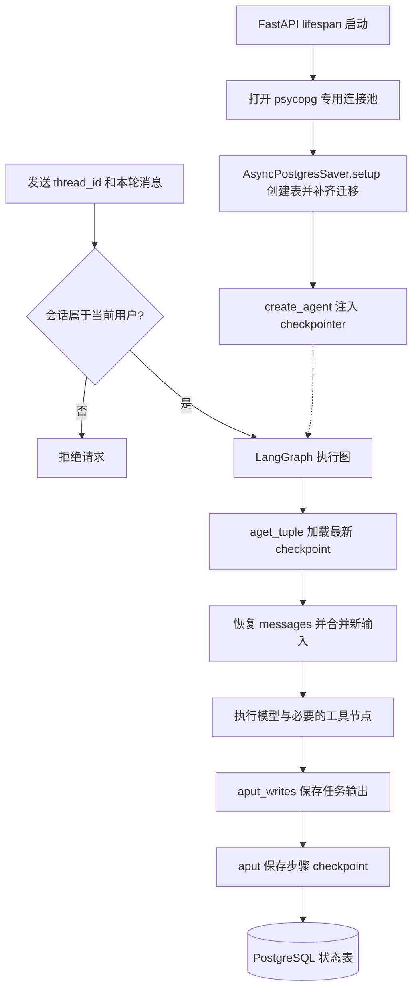
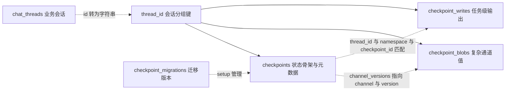
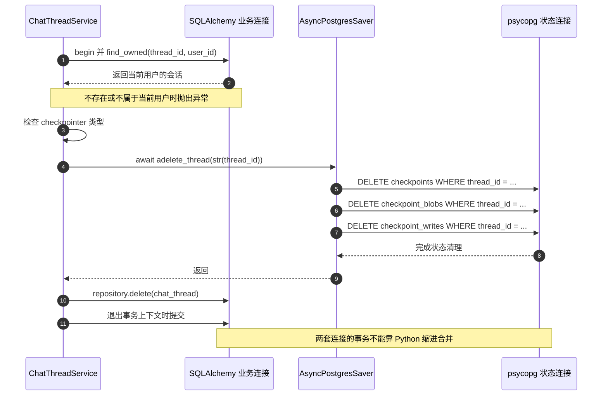

# 01 PostgreSQL 检查点的存储与删除

> 主题：LangChain / LangGraph 的 PostgreSQL 持久化。本文将同一主题下的五个问题放在一起。
> 首次整理：2026-11-14。结论以当前项目版本为边界；升级依赖后应重新核对。

## 问题索引

| 编号 | 问题 | 状态 |
| --- | --- | --- |
| Q001 | 本项目如何通过 checkpointer 把 Agent 状态保存到 PostgreSQL？ | 已核对代码与依赖源码 |
| Q002 | 数据库有哪些表？消息、checkpoint、pending writes 分别存在哪里？ | 已核对代码与依赖源码 |
| Q003 | 下一轮对话与历史记录如何从数据库恢复？ | 已核对代码与依赖源码 |
| Q004 | 为什么调用 `adelete_thread(thread_id)` 就能清理 checkpoint？ | 已核对代码与依赖源码 |
| Q005 | 删除会话时，两套数据库操作能一起回滚吗？ | 已核对代码与依赖源码 |

**配套资料**：[问题索引](00-问题索引.md) · [详细交互流程图](流程图/01-PostgreSQL检查点的存储与删除.html) · [可编辑 draw.io 图源](图源/01-PostgreSQL检查点的存储与删除.drawio)。正文直接嵌入 Mermaid 图，支持 Mermaid 的 Markdown 阅读器可就地渲染。

## 阅读范围与证据

你提供的入口是 [JavaScript Checkpointers 文档](https://docs.langchain.com/oss/javascript/langgraph/checkpointers#checkpoints)。它解释的是 LangGraph 的持久化机制；本项目实际运行的是 **Python LangChain Agent + LangGraph + AsyncPostgresSaver**。概念可以对应，具体方法名、序列化与 SQL 以 Python 实现为准。

本次同时核对了 `uv.lock` 与 `.venv` 中实际安装的包。流程图基于当前工作区代码快照，其中部分业务代码尚未提交；图内快照修订号不是远程仓库提交号。

| 依赖 | 当前版本 |
| --- | --- |
| `langgraph` | `1.2.21` |
| `langgraph-checkpoint` | `4.3.1` |
| `langgraph-checkpoint-postgres` | `3.2.0` |

证据分为三类：**项目事实**来自仓库；**库实现**来自本地已安装的对应版本源码；**示意**用于理解关系，不代表真实数据库记录。本次没有连接业务数据库、读取用户消息或执行删除。

项目入口：

- [启动与关闭](../../agent-service/app/main.py)：`lifespan()`。
- [checkpointer 初始化](../../agent-service/app/infra/checkpointer.py)：`init_checkpointer()`。
- [Agent 创建](../../agent-service/app/agents/insurance_advisor.py)：`init_insurance_agent()`。
- [聊天执行](../../agent-service/app/modules/chat/service.py)：`chat_stream()`。
- [历史读取与删除](../../agent-service/app/modules/chat_thread/service.py)：`get_history()`、`delete()`。
- [业务表](../../agent-service/app/modules/chat_thread/models.py)：`ChatThread`。
- [两种连接字符串](../../agent-service/app/core/config.py)：`DBSettings.url`、`checkpoint_url`。

本地库实现（安装依赖后可查看，`.venv` 不应提交）：

- `agent-service/.venv/lib/python3.14/site-packages/langgraph/checkpoint/postgres/aio.py`：`setup`、`aput`、`aput_writes`、`aget_tuple`、`adelete_thread`、`_cursor`。
- `agent-service/.venv/lib/python3.14/site-packages/langgraph/checkpoint/postgres/base.py`：`MIGRATIONS`、`SELECT_SQL`、序列化辅助方法。
- `agent-service/.venv/lib/python3.14/site-packages/langchain/agents/middleware/types.py`：`AgentState.messages` 的 `add_messages` reducer。

## Q001：当前项目如何与 PostgreSQL checkpoint 结合？

**先记住：LangGraph 负责决定何时保存、恢复什么状态；checkpointer 负责把这些状态转换为数据库读写。** 给 Agent 注入 `AsyncPostgresSaver` 后，业务接口无需在每轮回答结束时手写消息 INSERT。

### 1. 服务启动时接好持久化后端

当前调用顺序：

1. `lifespan()` 调用 `init_checkpointer()`。
2. 打开专用的 `psycopg_pool.AsyncConnectionPool`，等待连接可用。
3. `AsyncPostgresSaver(checkpoint_pool)` 创建数据库适配器。
4. `await checkpointer.setup()` 创建所需表并执行未完成的迁移。
5. `create_agent(..., checkpointer=checkpointer)` 把适配器绑定到图运行时。
6. Agent 保存在 `app.state.agent`，后续请求复用。

核心项目代码（省略模型配置）：

```python
checkpointer = AsyncPostgresSaver(checkpoint_pool)
await checkpointer.setup()

agent = create_agent(
    model=model,
    tools=[query_candidate_products],
    system_prompt=SYSTEM_PROMPT,
    checkpointer=checkpointer,
)
```

`setup()` 并不执行对话，也不创建一条业务会话。它读取 `checkpoint_migrations` 的最大迁移编号，再按顺序应用缺失迁移；当前项目在每次服务启动时调用它。

### 2. 发起对话时，用同一个 thread_id 找回同一份状态

当前聊天接口先校验会话归属，然后传入：

```python
config = {"configurable": {"thread_id": str(request.thread_id)}}
_input = {"messages": [HumanMessage(content=request.message)]}

stream = await self.agent.astream_events(_input, config, version="v3")
```

此处 `thread_id` 就是业务表 `chat_threads.id` 的字符串形式。这是项目自己建立的对应关系，LangGraph 不会自动查询 `chat_threads`。

运行时大致完成：读取已有 checkpoint → 合并本轮输入 → 执行节点 → 保存节点 writes 和步骤 checkpoint → 输出事件。真实执行中，流式事件与持久化存在交错；不能把“收到一个 token”理解成“数据库已新增一个 checkpoint”。

### 3. 两个连接池，当前指向同一个数据库

| 负责什么 | 客户端 / 驱动 | 当前连接来源 |
| --- | --- | --- |
| 用户、会话标题等业务记录 | SQLAlchemy AsyncSession / asyncpg | `settings.db.url`，协议 `postgresql+asyncpg` |
| 图状态与执行恢复 | AsyncPostgresSaver / psycopg | `settings.db.checkpoint_url`，协议 `postgresql` |

这两个 URL 使用相同 host、port、database 等配置拼接。**当前是同一 PostgreSQL 数据库、不同连接池和连接；不是“LangGraph 内置了一个 PostgreSQL 数据库”。**

初始化参数中，`autocommit=True` 支持迁移过程中的并发建索引等操作；`dict_row` 让查询结果能按列名访问。还有一个容易误读的地方：本项目注释写 `prepare_threshold=0` 为“不做预准备 sql”，但 psycopg 中 **`0` 表示立即准备，`None` 才表示禁用自动准备**。这是现有注释偏差，本次只记录，没有修改运行代码。


### 图 1：接入与持久化职责



此图强调依赖与职责，流式事件可与持久化交错；不表示每收到一个 token 都保存一次 checkpoint。

## Q002：checkpoint 到底是什么，数据库怎么存？

### 1. 先区分五个概念

| 概念 | 含义 | 本项目中的例子 |
| --- | --- | --- |
| 业务会话 | 产品侧的一条聊天记录入口 | `chat_threads` 中的标题、user_id |
| thread | 一组图执行状态的归属标识 | `str(chat_threads.id)` |
| run | 一次图调用 | 用户发送一条新问题触发的一次执行 |
| checkpoint | 某个 super-step 边界的持久化状态 | 输入处理后、模型节点完成后的状态 |
| checkpointer | 读写 checkpoint 的适配器对象 | `AsyncPostgresSaver` |

**一个 thread 可以有多次 run，一次 run 可以生成多个 checkpoint。** super-step 是图调度的一步，其中可并行执行多个节点；它不是一个 token，也不固定等于一条消息。当前工作区已接入 `query_candidate_products` 工具；有无工具都会存在输入处理和模型执行等步骤，工具调用还可能产生额外步骤。

官方高层接口用 `StateSnapshot` 表达可查看的图状态；数据库里保存的是底层 checkpoint、metadata、channel 数据和 task writes，运行时再据此构造 `StateSnapshot`。数据库行并不等同于把整个 Python `StateSnapshot` 对象直接转成 JSON。

### 2. 四张库表与一张业务表

以下类型与主键来自当前安装版本的迁移定义；业务表来自项目 ORM。实际部署的 schema/search_path、迁移进度仍应在目标数据库核对。

| 表 | 保存内容 | 主键 |
| --- | --- | --- |
| `chat_threads` | 业务侧会话归属、标题、时间等 | `id`，UUID |
| `checkpoints` | checkpoint 主体、元数据、父 checkpoint 标识 | `(thread_id, checkpoint_ns, checkpoint_id)` |
| `checkpoint_blobs` | 按 channel/version 存的复杂通道值 | `(thread_id, checkpoint_ns, channel, version)` |
| `checkpoint_writes` | 节点任务的中间输出，用于恢复等 | `(thread_id, checkpoint_ns, checkpoint_id, task_id, idx)` |
| `checkpoint_migrations` | 库自身的数据库迁移进度 | `v`，INTEGER |

**这里不存在库自动创建的 `threads` 主表，也没有指向业务 `chat_threads.id` 的外键。** 库表之间的逻辑引用也没有在上述迁移里声明成外键。

#### checkpoints：状态骨架与版本引用

| 字段 | PostgreSQL 类型 | 作用 |
| --- | --- | --- |
| `thread_id` | TEXT NOT NULL | 所属会话 |
| `checkpoint_ns` | TEXT NOT NULL，默认 `''` | 图 / 子图命名空间；根图通常为空 |
| `checkpoint_id` | TEXT NOT NULL | 此次 checkpoint 的 ID |
| `parent_checkpoint_id` | TEXT，可空 | 父 checkpoint，支持历史链及分支关系 |
| `type` | TEXT，可空 | 迁移保留字段；当前 `aput` INSERT 不写它 |
| `checkpoint` | JSONB NOT NULL | 状态骨架、版本映射和部分通道值 |
| `metadata` | JSONB NOT NULL，默认 `{}` | 步骤、来源等执行元数据 |

`checkpoint` 中可见 `id`、`ts`、`v`、`channel_versions`、`versions_seen`、`channel_values` 等。`v` 是 checkpoint 格式版本，不是迁移编号，也不是消息数量；`versions_seen` 帮助运行时判断节点已消费过哪些通道版本。

#### checkpoint_blobs：复杂状态的序列化值

| 字段 | PostgreSQL 类型 | 作用 |
| --- | --- | --- |
| `thread_id`、`checkpoint_ns` | TEXT NOT NULL | 定位会话和命名空间 |
| `channel` | TEXT NOT NULL | 通道名，例如 `messages` |
| `version` | TEXT NOT NULL | 通道版本，不能当成消息序号 |
| `type` | TEXT NOT NULL | 序列化类型标签 |
| `blob` | BYTEA，可空 | 序列化内容 |

当前 `aput()` 将 `None/str/int/float/bool` 这类值直接保留在 checkpoint JSONB 中；列表、消息对象等复杂值进入 blobs。默认序列化器支持带类型的编码，常见类型标签为 `msgpack`，但不应把它写死为唯一格式。数据库客户端里的 BYTEA 十六进制显示不是聊天正文。

对于本项目默认 `messages` 通道，新增消息经过 reducer 合并后形成新的消息列表，复杂列表按通道版本保存。**这不是“一条消息对应 blobs 的一行”，也不保证每次只保存新增文本。** 未改变的复杂通道版本可被多个 checkpoint 引用，不必为每个 checkpoint 再复制同一版值。

库中还支持 `_DeltaSnapshot` / DeltaChannel 等路径；本项目当前默认 `AgentState.messages` 使用 `add_messages`，本节示例按该路径理解，不把所有通道都假定为同一种增量存储策略。

#### checkpoint_writes：任务级中间结果

| 字段 | PostgreSQL 类型 | 作用 |
| --- | --- | --- |
| `thread_id`、`checkpoint_ns`、`checkpoint_id` | TEXT NOT NULL | 与执行中的 checkpoint 关联 |
| `task_id` | TEXT NOT NULL | 节点任务 ID |
| `idx` | INTEGER NOT NULL | 同任务写入序号；特殊通道可能使用预定义索引 |
| `channel` | TEXT NOT NULL | 输出所属通道 |
| `type` | TEXT，可空 | 序列化标签 |
| `blob` | BYTEA NOT NULL | 序列化的节点输出 |
| `task_path` | TEXT NOT NULL，默认 `''` | 任务路径，用于排序等 |

为什么有完整 checkpoint，还需要 writes？例如同一步并行执行 A、B，A 成功而 B 失败，已持久化的 A 输出可以用于恢复，避免成功节点无谓重跑。writes 不等于一个完整 checkpoint；当前 saver 也没有“每写入完整 checkpoint 就立即清空该 thread 的 writes”的逻辑。

### 3. 用一组示意值看清引用关系

假设会话为 `T`，根命名空间为空，有两个示意 checkpoint `C1`、`C2`：

| checkpoints 行 | `channel_versions.messages`（示意） | 对应 messages 状态 |
| --- | --- | --- |
| `(T, '', C1)` | `V1` | `[用户：你好]` |
| `(T, '', C2)` | `V2` | `[用户：你好, AI：你好，我能帮你什么？]` |

blobs 中是 `(T, '', 'messages', V1)` 和 `(T, '', 'messages', V2)` 两个版本。`C2.parent_checkpoint_id = C1`。真实 ID/版本更长，这里的符号不是可直接写入数据库的值。

读取 `C2` 时，saver 根据 `channel_versions` 中的通道名和版本，连同 `thread_id`、`checkpoint_ns` 匹配 blobs；不是把这个 thread 的所有 blobs 全部无序拼起来。

**落库路径：**

1. `aput_writes()` 将任务输出写入 `checkpoint_writes`。
2. `aput()` 对复杂通道的新版本执行 blobs INSERT，主键冲突时 `DO NOTHING`。
3. `aput()` UPSERT checkpoint 主体，并记下父 checkpoint ID 与 metadata。

这说明职责，不表示每次请求只各调用一次，也不表示流式输出必须等全部写入结束才开始。


### 图 2：状态骨架与复杂值的逻辑关联



实线表示归属，虚线表示代码中的逻辑映射或管理关系。**这些线不是 PostgreSQL 外键**；实际字段、复合主键及序列化说明见本节表格。

## Q003：下一轮为什么能记得之前的话？历史记录又如何读取？

### 1. 同一 thread_id 会重新读取保存的状态

下一轮仍然传 `T`，运行时通过 `aget_tuple()` 获取状态。没有指定 `checkpoint_id` 时，当前 saver 的定位条件是：

```sql
-- 这里只展示 checkpoint 主体定位；真实 SELECT 还会关联 blobs 和 writes。
SELECT *
FROM checkpoints
WHERE thread_id = %s AND checkpoint_ns = %s
ORDER BY checkpoint_id DESC
LIMIT 1;
```

根图默认 namespace 是 `''`；指定 `checkpoint_id` 则定位到对应历史 checkpoint。随后 `_load_checkpoint_tuple()` 合并 JSONB 内联值和反序列化的 blobs，并带上 metadata、父配置及 pending writes，供图运行时重建状态。

`messages` 使用 `add_messages` reducer 合并已有消息与新输入：通常新 ID 消息追加，相同 ID 消息更新，也支持删除消息的语义。**不是每次调用都用本轮输入覆盖整个消息列表。**

因此请求只发新增 `HumanMessage` 即可。模型本身没有因为 PostgreSQL 自动获得记忆；是运行时恢复消息后，再由 Agent 组织模型输入。

复用 thread ID 并不一概等于“断点续跑”：本项目提交新输入，会在已保存状态上处理新一轮；错误后恢复、中断回复、历史重放还有各自的调用方式。

### 2. 当前历史接口读取最新状态中的 messages

项目中的实际逻辑：

```python
config = {"configurable": {"thread_id": str(thread_id)}}
snapshot = await self.agent.aget_state(config)
messages = snapshot.values.get("messages", [])
```

再把 `HumanMessage`、`AIMessage` 的非空文本转换成接口响应；其他消息类型被过滤。**该接口展示的是最新状态里的消息列表，不是遍历所有 checkpoint 来拼聊天记录。** 若将来增加裁剪、摘要或删消息逻辑，历史接口也会随最新状态变化。

要研究每一步的历史状态，使用 `agent.aget_state_history(config)`；要研究底层持久化数据，才直接使用 saver 的 `aget_tuple()` / `alist()`。业务展示优先用图状态 API，避免自己解析 BYTEA 或耦合内部表结构。

### 3. 没有 checkpoint 的业务会话也可以存在

当前“创建会话”只插入 `chat_threads`，第一次图执行后才会产生相应 checkpoint 数据。所以业务会话列表与 checkpoint 表的记录数量不应一一对应。直接删除业务表行也不会自动触发库表清理。

## Q004：为什么删除时直接调用 checkpointer.adelete_thread 就行？

**因为这个方法本来就封装了“按会话标识清除全部 checkpoint 持久化数据”的 SQL。** 它不需要先逐个列出 checkpoint，再由业务代码循环删除。

### 1. 名字与调用方式

你提到的 `deleter——thread`，在本项目对应：

```python
await checkpointer.adelete_thread(str(thread_id))
```

Python 同步版本叫 `delete_thread()`，异步版本带 `a` 前缀。JavaScript 的命名另有差异，不要直接把示例方法名复制到 Python。

### 2. 当前版本内部做了什么？

以下是已安装版本 `AsyncPostgresSaver.adelete_thread()` 的核心实现：

```python
async with self._cursor(pipeline=True) as cur:
    await cur.execute(
        "DELETE FROM checkpoints WHERE thread_id = %s", (str(thread_id),)
    )
    await cur.execute(
        "DELETE FROM checkpoint_blobs WHERE thread_id = %s", (str(thread_id),)
    )
    await cur.execute(
        "DELETE FROM checkpoint_writes WHERE thread_id = %s", (str(thread_id),)
    )
```

三张表每行都携带 `thread_id`，所以传一个 ID 就足以清理该 thread 的所有版本、checkpoint、任务写入。条件里没有 namespace 或 checkpoint ID，因此会覆盖这个 thread 下的全部命名空间与历史分支。迁移还为三张表分别建立了 `thread_id` 索引。

这段 SQL **显式删除三张表，完全不依赖 `ON DELETE CASCADE`**。如果只删 `checkpoints`，其余两表并不会因这些迁移定义而自动删除。

### 3. “调用它就够了”的边界

| 数据 / 行为 | `adelete_thread()` 是否处理 |
| --- | --- |
| 对应 thread 的 checkpoints、blobs、writes | 是 |
| 所有 namespace、历史 checkpoint 和分支 | 是，按 thread_id 全量匹配 |
| `checkpoint_migrations` | 否，它是数据库级迁移记录 |
| 业务 `chat_threads` 行 | 否，项目另外调用 repository.delete |
| 用户、业务资料、向量库、跨会话 Store | 否 |
| 校验这个 thread 是否属于当前用户 | 否，业务层先查 `find_owned` |
| 取消已在执行的 Agent、禁止未来写回 | 否 |
| 永久注销这个 thread_id | 否，未来图调用仍能用同一 ID 写入新数据 |

本项目的完整会话删除流程因此是：**校验归属 → 删除 checkpoint 数据 → 删除业务会话行 → 提交业务事务**。

`isinstance(checkpointer, BaseCheckpointSaver)` 只是项目对对象类型的检查；真正执行 PostgreSQL SQL 的是运行时实际对象 `AsyncPostgresSaver`。不能据此推断所有 BaseCheckpointSaver 子类都支持同样的数据库结构或清理能力。


### 图 3：删除会话的实际调用顺序



`repository.delete` 先标记 ORM 对象，实际 DELETE 可在 flush / commit 时发出。图中展示成功路径；后续章节单独讨论失败与回滚。

## Q005：删除操作是在一个事务里吗？

**当前项目没有覆盖业务表与 checkpoint 表的共同事务。**

容易误读的是这一段：

```python
async with self.session.begin():
    # 省略归属检查与类型检查
    await checkpointer.adelete_thread(str(thread_id))
    await self.repository.delete(chat_thread)
```

`self.session.begin()` 只管理 SQLAlchemy 使用的连接；checkpointer 从另外的 psycopg 连接池借连接，不会因为 Python 的缩进嵌套就自动加入这个事务。即使两个池连接同一个 PostgreSQL database，也仍然是两条连接上的操作。

### 1. 一个具体失败场景

1. 业务事务查询到会话 T，归属校验通过。
2. saver 成功清除了 T 的 checkpoint 数据。
3. 业务表删除 / 提交失败，SQLAlchemy 回滚。
4. 结果：`chat_threads` 中 T 还在，checkpoint 数据已经清除，业务回滚无法将它恢复。

所以不能把它描述成“数据库保证整条会话和所有历史原子删除”。

### 2. saver 内部三条 DELETE 又是什么关系？

本版本 `adelete_thread()` 使用 `_cursor(pipeline=True)`。支持 pipeline 时使用 psycopg pipeline；不支持时 `_cursor` 显式使用 `conn.transaction()`。pipeline 的同步点、隐式事务语义也影响其内部提交边界，因此不能仅凭 `autocommit=True` 就断言三条 DELETE 必然各自独立提交。

这里已经能从源码确认的关键结论是：**saver 内部的操作不属于外面的 SQLAlchemy 业务事务。** 当前实现还没有把会话删除与正在运行的 Agent 写入互斥起来；已通过归属检查的聊天执行，可能在清理后继续产生写入。

### 3. 后续如果需要更强的一致性

可先明确产品需求，再选择方案：给会话增加删除状态并阻止新请求，协调 / 等待同 thread 的运行结束，记录清理任务并重试，或重新设计能共享事务边界的持久化路径。这些是改进方向，本次没有实现；不能仅把删除顺序交换一下就认为解决了原子性。

## 如何亲自观察：只读排查清单

以下 SQL 是供手动观察的示例，**本次没有在数据库执行**。先连接正确数据库；若 schema 不在当前 search_path，请添加实际 schema 前缀。`<thread-id>` 替换为自己的完整会话 UUID 字符串。

```sql
-- 1. 当前 schema 下有哪些 checkpoint 表？
SELECT table_schema, table_name
FROM information_schema.tables
WHERE table_name IN (
    'chat_threads', 'checkpoints', 'checkpoint_blobs',
    'checkpoint_writes', 'checkpoint_migrations'
)
ORDER BY table_schema, table_name;

-- 2. 一个 thread 保存了多少个 checkpoint、位于哪些 namespace？
SELECT checkpoint_ns, count(*) AS checkpoint_count
FROM checkpoints
WHERE thread_id = '<thread-id>'
GROUP BY checkpoint_ns;

-- 3. 最新 checkpoint 的骨架和消息通道版本。
SELECT checkpoint_id, parent_checkpoint_id,
       metadata ->> 'step' AS step,
       checkpoint -> 'channel_versions' ->> 'messages' AS messages_version,
       checkpoint -> 'channel_values' AS inline_values
FROM checkpoints
WHERE thread_id = '<thread-id>' AND checkpoint_ns = ''
ORDER BY checkpoint_id DESC
LIMIT 5;

-- 4. 查看二进制值的类型与大小，不直接展开消息内容。
SELECT checkpoint_ns, channel, version, type,
       octet_length(blob) AS bytes
FROM checkpoint_blobs
WHERE thread_id = '<thread-id>'
ORDER BY checkpoint_ns, channel, version;

-- 5. 查看任务级写入的定位信息。
SELECT checkpoint_ns, checkpoint_id, task_id, idx, channel, type, task_path
FROM checkpoint_writes
WHERE thread_id = '<thread-id>'
ORDER BY checkpoint_id DESC, task_id, idx;
```

建议观察顺序：创建业务会话 → 发送第一轮问题 → 发送第二轮问题 → 对照 checkpoint 数量、版本与 `aget_state()` 返回的 messages。不要期待一轮固定新增一条 checkpoint，或一条消息固定新增一条 blob。

## 常见误解速查

| 误解 | 当前项目中的准确理解 |
| --- | --- |
| checkpointer 就是内存聊天记录 | 它是状态持久化接口；当前实现落在 PostgreSQL |
| 一个 checkpoint 就是一条消息 | 它是步骤状态，可能含累计消息、控制信息及其他通道 |
| 所有消息直接在 checkpoint JSONB 里 | 当前复杂 messages 列表通常由 blobs 保存，JSONB 保留版本引用 |
| thread_id 是这几张表唯一的单列主键 | 它是会话分组键，各数据表使用复合主键 |
| 删除依赖业务表外键级联 | 当前是 saver 显式删除三张表，业务表另外删除 |
| 给了相同 thread_id 就一定从出错位置续跑 | 本项目提供新输入，进入新一轮；恢复语义还取决于输入与调用方式 |
| 外面包了 session.begin 就全能回滚 | 两套连接有独立事务边界 |
| 删除之后仍在运行的请求自然停止 | 需要业务层另行协调执行与删除 |

## 官方资料与后续复核入口

- [用户提供的 JavaScript Checkpointers 页面](https://docs.langchain.com/oss/javascript/langgraph/checkpointers#checkpoints)：高层概念与 API 示意；不作为本项目 Python 表结构的唯一依据。
- [Python 持久化说明](https://docs.langchain.com/oss/python/langgraph/persistence)：用于后续复核图状态、历史和恢复概念。
- [官方 PostgreSQL checkpointer 包源码与说明](https://github.com/langchain-ai/langgraph/tree/main/libs/checkpoint-postgres)：可追踪版本差异。本笔记的实现细节以本地 `3.2.0` 包为准，网页 main 可能继续变化。
- [官方 aio.py](https://github.com/langchain-ai/langgraph/blob/main/libs/checkpoint-postgres/langgraph/checkpoint/postgres/aio.py)：可定位同名方法。
- [官方 base.py](https://github.com/langchain-ai/langgraph/blob/main/libs/checkpoint-postgres/langgraph/checkpoint/postgres/base.py)：可定位迁移、主键、SQL 和序列化辅助方法。
- [psycopg prepared statements](https://www.psycopg.org/psycopg3/docs/advanced/prepare.html)：`prepare_threshold` 的准确含义；本次还对照了本地 `psycopg/_preparing.py`。

## 后续维护

本文是第 01 篇，围绕 PostgreSQL checkpoint 存储与删除组织。新的独立主题请另建 `02-主题名称.md`，不要继续把所有问题追加进这一篇。目录规范与模板见 [00-问题索引](00-问题索引.md)。
