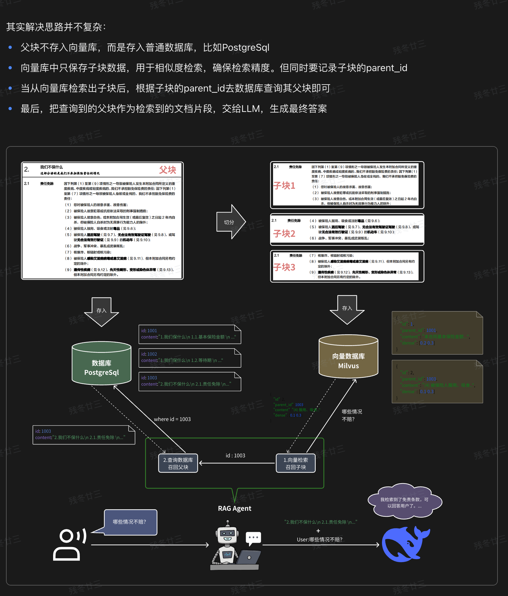
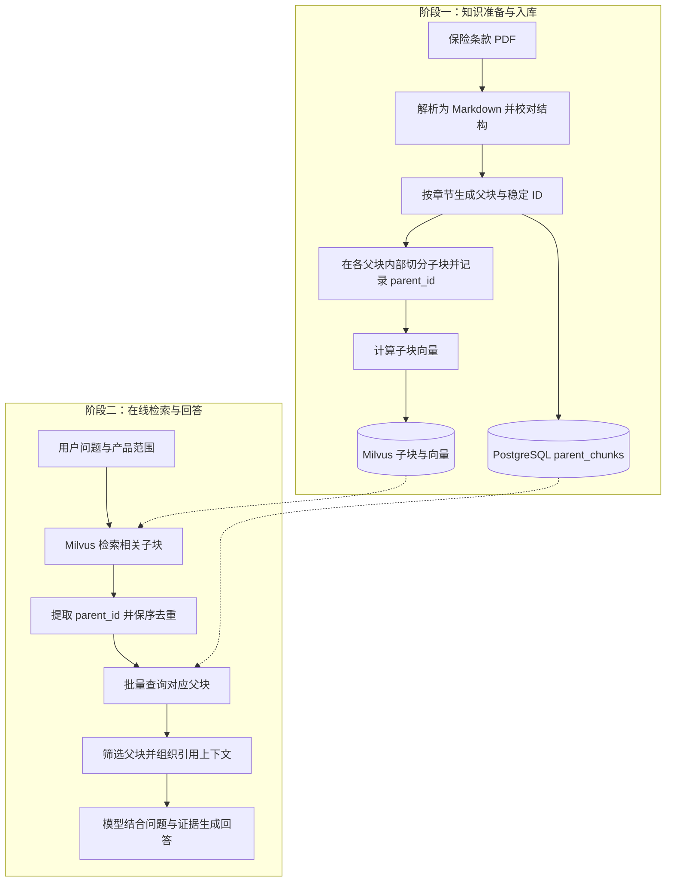
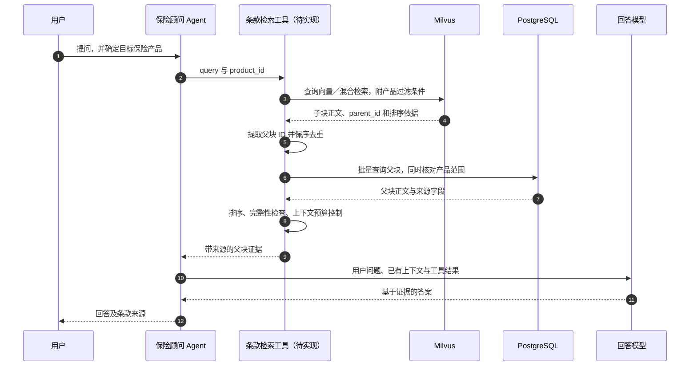

# 01 父子分块检索与保险条款问答

> 分析日期：2026-11-15
> 目标：解释参考图中“Milvus 检索子块 → 按 parent_id 从 PostgreSQL 回查父块 → 交给模型回答”的完整流程。
> 实现边界：当前项目已有父块表 SQL、文档解析和 Milvus 检索示例；完整父子块入库、父块回查及保险条款检索工具尚未接入业务 Agent。下文的设计、伪代码和示例数据不代表已经实现。

## 1. 先用一句话理解

**用较小的子块定位相关内容，再取回包含它的父块，让模型带着完整语境回答。**

例如，用户问某款保险“哪些情况不赔”，向量检索可能只命中责任免除中的一项。如果只给模型这一项，它可能遗漏前面的适用条件、后面的例外说明。回查父块后，可以把这一节的上下文一起交给模型。

这里要解决的是两个目标之间的取舍：检索时希望文本主题集中，回答时希望证据上下文足够完整。这个思路通常称为父子文档检索或 Small-to-Big Retrieval。

### 原始参考图



原图由用户提供，作为设计参考。图中的 `1001/1003`、二维向量等均是示意值；本项目父块主键实际定义为 UUID，不能直接照搬这些整数。

## 2. 图中每个角色负责什么

| 角色 | 负责什么 | 不应混淆的概念 |
| --- | --- | --- |
| 原始条款 PDF | 提供保险产品条款原文 | PDF 文件不等于一个检索块 |
| 文档解析器 | 将 PDF 解析成文本、Markdown 和结构信息 | 解析错误会直接影响后续检索证据 |
| 父块 | 保存相对完整的语义单元，如一个条款小节 | 可以是较大的分块，不必是整份 PDF |
| 子块 | 从某个父块内部再次切分出的较小片段 | 每个子块应明确属于哪个父块 |
| Embedding 模型 | 把子块和查询转换成可比较的向量 | 不负责生成最终回答 |
| Milvus | 保存子块、向量及检索过滤所需的标量字段 | 不是只保存向量，也不会自动关联 PostgreSQL |
| PostgreSQL | 按父块 ID 保存、查询完整正文和来源信息 | 回查依赖 ID，不再做一次向量搜索 |
| 检索工具 | 串起子块召回、父块回查、去重与上下文整理 | 不是数据库之间自动完成的 JOIN |
| Agent / LLM | 结合用户问题和检索证据生成回答 | 模型不会因为拿到 parent_id 就自行查询数据库 |

**两种 ID 必须分开：**`child_id` 标识一个子块，`parent_id` 指向 PostgreSQL 中的父块 `id`。它们不能因为文本相似就互相替代。

## 3. 与当前项目的对应关系

| 能力 | 已检查的位置 | 当前事实 |
| --- | --- | --- |
| 父块存储结构 | [02-init-agent-schema.sql](../../deploy/postgres/init/02-init-agent-schema.sql) | 已定义 `parent_chunks`，包括产品、条款文件名、标题路径和正文；本次未查询实际数据库迁移进度 |
| PDF / Markdown 解析与切分 | [RAG 预览 Notebook](<../../agent-service/notebooks/day07/01.RAG 预览.ipynb>) | 演示了 PDF 加载、MinerU 解析、字符切分和 Markdown 标题切分 |
| 稠密向量与中文 BM25 混合检索 | [LangChain-Milvus Notebook](../../agent-service/notebooks/day08/02.LangChain-Milvus.ipynb) | 演示了 Milvus、`dense/sparse`、加权融合、RRF 和表达式过滤 |
| 连接与解析配置 | [config.py](../../agent-service/app/core/config.py) | 已有 `RAGSettings`、MinerU token 配置和 Milvus 地址拼接 |
| 业务 Agent 工具 | [insurance_advisor.py](../../agent-service/app/agents/insurance_advisor.py)、[tools.py](../../agent-service/app/agents/tools.py) | 当前注册的是候选产品查询和方案保存，没有父子块条款检索工具 |
| 父子块关联与回查服务 | `agent-service/app/` | 当前未发现对应业务模型、仓储、入库服务或检索工具实现 |

Notebook 中给普通文档设置 `doc.id = str(i)`，只是在设置文档自身 ID；它不会自动生成父子关系，也不会把父正文写入 `parent_chunks`。

Milvus Notebook 中的 `drop_old=True` 是重建实验 collection 的配置。后续接入真实知识库时不能原样作为日常请求逻辑，否则可能清空旧 collection。

## 4. 整个流程分成两个阶段

**离线准备阶段**负责把条款变成可检索的数据；这里的“离线”指不在用户每次提问时执行，不表示不使用网络服务。

**在线问答阶段**负责在用户提问时检索已有数据、组织证据和生成回答，不需要重新解析整份 PDF。



## 5. 阶段一：条款如何入库

### 5.1 先确认文档身份

解析之前应知道这份条款属于哪个产品、是哪份文件、对应哪个版本。否则，即使检索命中了正确的小节，也可能来自另一款产品或旧版本。

当前父块表已经有 `product_id` 和 `clause_name`。`document_version`、文件哈希、原 PDF 页码等属于后续可补充的溯源信息，**当前这张表没有这些字段**。

### 5.2 解析 PDF，保留条款结构

理想的解析结果应尽量保留：

- 标题层级，例如“责任免除 → 某条款小节”。
- 有序条目及所属的引导句，避免把一条限制条件切成另一个主题。
- 表格、脚注、例外说明和交叉引用。
- 对应文件、页码或其他可定位原文的信息。

例如，父块正文可以包含小节标题、适用条件和若干子项。不能只因为两段文字来自同一页，就认定它们应当构成同一个父块。

### 5.3 先划父块，再从每个父块内部划子块

建议的组织顺序是：

1. 按 Markdown 标题或条款结构识别父块边界。
2. 为每个父块生成 ID，保留产品和来源信息。
3. 在单个父块内部切分子块。
4. 每个子块都附带这个父块的 ID。

这样可以保证父子对应关系明确。若先把整份文档随意切小，再靠正文匹配去猜父块，重复标题、相似措辞和跨页条款都会增加歧义。

父块也需要长度控制：过长的一个章节可拆成几个语义完整的父块；过小则无法补充上下文。子块可以有适量重叠，避免句子或条目在边界处被截断，但不应跨到不属于它的父块。

`chunk_size` 的单位取决于切分器的长度函数。按字符切分的 `400` 不等于 `400 tokens`，不能直接拿来计算模型输入预算。

### 5.4 将父块写入 PostgreSQL

本项目已有的表定义如下，省略无关 SQL：

```sql
CREATE TABLE IF NOT EXISTS parent_chunks (
    id UUID PRIMARY KEY,
    product_id BIGINT NOT NULL,
    clause_name VARCHAR(300) NOT NULL,
    section_path TEXT[] NOT NULL DEFAULT ARRAY[]::TEXT[],
    content TEXT NOT NULL,
    created_at TIMESTAMP WITH TIME ZONE NOT NULL DEFAULT CURRENT_TIMESTAMP
);

CREATE INDEX IF NOT EXISTS idx_parent_chunks_product
    ON parent_chunks(product_id);
```

| 字段 | 在本流程中的用途 |
| --- | --- |
| `id` | 父块身份，是子块 `parent_id` 的匹配目标 |
| `product_id` | 控制产品范围，避免将不同产品的同名条款混用 |
| `clause_name` | 标识条款文件，当前注释要求保留 `.pdf` 后缀 |
| `section_path` | 保存 Markdown 标题路径，帮助生成检索上下文和引用 |
| `content` | 提供给模型的父块正文 |
| `created_at` | 记录创建时间，不能独自代表条款版本 |

需要注意：这份 DDL 没有为 `product_id` 声明外键，也没有实现按来源去重或版本唯一性。这些不是表名本身会自动保证的能力。

### 5.5 子块进入 Milvus，并携带 parent_id

下面只是**建议的逻辑记录格式**，不是当前 Notebook 已创建的 collection schema：

```json
{
  "child_id": "child-a-02",
  "parent_id": "6f3e0048-ea21-40df-937c-14803cb794ad",
  "product_id": 101,
  "clause_name": "示例产品条款.pdf",
  "section_path": ["责任免除", "适用范围"],
  "child_index": 1,
  "content": "示例子块正文……",
  "dense": [0.2, 0.3]
}
```

这里最关键的是：

- `parent_id` 的字符串值必须能够还原成父块 UUID，入库时就应检查。
- `content` 是子块文本，可以在其前面补充适量的产品名、条款名和标题，帮助表达语义；正文与检索辅助文本如何区分，需要保持约定一致。
- `dense` 是 Embedding 结果。上面的两个数仅用于展示格式；当前 Notebook 配置的是 1024 维，应以实际模型输出和 collection 定义为准。
- 若使用中文 BM25 混合检索，还需要对应的文本字段、分析器和稀疏向量配置，不是增加一个 JSON 字段就会自动启用。
- `parent_id`、`product_id` 等应配置成能够随检索结果返回、必要时可过滤的字段；如果走 LangChain metadata，也要确认其映射和输出配置。

父块可以只存 PostgreSQL、完全不做向量化，这是图中的方案选择；并非框架或数据库禁止父块也建立向量索引。

### 5.6 两个数据库没有共同事务

PostgreSQL 写成功，不代表 Milvus 一定写成功，反过来也是如此。仅靠 Python 中连续调用两个方法，无法得到跨库原子性。

后续可采用“先写父块 → 写子块 → 校验关联完整 → 对外发布”的导入过程，并为失败批次保留重试和清理依据。发布状态、批次 ID 或索引版本都需要另外设计，当前父块表没有这些字段。

若只有父块、没有子块，这段知识暂时无法被向量检索发现；若只有子块、没有对应父块，就会出现命中了知识却无法取得完整正文的问题。

## 6. 阶段二：用户提问后具体发生什么

假设用户正在查看产品 `101`，问：“这款产品有哪些不赔的情况？”

### 6.1 先确定检索范围

本次查询应尽量明确产品 ID、有效条款文件或版本。只有用户问“这款产品”而系统不知道具体是哪款时，应先确定指代，不能把所有产品的责任免除混成一个答案。

确认范围后，将它转换为检索过滤条件；这和对自然语言问题做 Embedding 是两个不同动作。

### 6.2 查询向量与子块索引匹配

查询文本需要进入与子块索引兼容的 Embedding 模型。模型、维度以及必要的归一化或任务配置都应保持一致；更换 Embedding 模型通常需要重新生成索引，不能只替换配置后继续使用旧向量。

Milvus 在给定范围内返回相近子块。项目的实验还演示了稠密检索与 BM25 的融合，可帮助处理条款名称、术语等关键词；这些实验目前并未组成父子块业务链路。

**小块并不自动等于高精度。** 小块可能主题更集中，也可能因为太短、缺少标题或解析有误而变得更难检索，效果需要通过实际问题评估。

### 6.3 从检索结果提取 parent_id，并保序去重

假设检索器按相关性返回以下示意结果：

| 返回顺序 | 子块 | 父块 | 说明 |
| --- | --- | --- | --- |
| 1 | A-2 | A | 命中一项责任免除 |
| 2 | A-1 | A | 命中同一父块中的另一部分 |
| 3 | B-1 | B | 命中相关定义 |
| 4 | A-3 | A | 仍然来自父块 A |

此时要回查的是 `[A, B]`，而不是 `[A, A, B, A]`。否则同一父块会被重复送入模型，浪费上下文并放大重复证据。

最简单的顺序策略是保留每个父块首次出现的位置。之后可以做父块级重排，但要明确采用何种依据，不能把不同检索器的分数直接相加。不同相似度／距离指标的大小方向也未必相同。

**子块 top-k 和父块数量不是一回事。** 检索出 8 个子块，去重后可能只有 1 个父块。若要兼顾覆盖范围，应根据父块数、证据质量和预算调整召回，而不是机械地认为“取 3 个子块就是取 3 段完整条款”。

### 6.4 PostgreSQL 一次批量回查父块

服务把去重后的 UUID 列表交给数据库，按主键批量查完整父块，并再次核对产品范围。逻辑 SQL 可以写成：

```sql
-- 示意参数：parent_ids 是 UUID 数组，product_id 是已确认的产品。
-- 实际占位符语法由 psycopg 或 SQLAlchemy 适配，不拼接用户输入。
SELECT id, product_id, clause_name, section_path, content
FROM parent_chunks
WHERE id = ANY(:parent_ids)
  AND product_id = :product_id;
```

这一步不是向量相似度计算，也不需要模型参与。通常应批量查询，避免命中 N 个子块就产生 N 次数据库请求。

SQL 的 `IN` / `ANY` 过滤**不保证返回顺序与输入 ID 顺序相同**。回查后需要按前一步的父块相关性顺序恢复排序。

若某个 `parent_id` 在数据库中不存在，应记录并排查关联缺失；不能随便拿别的产品父块填补。对于一般问答，可以明确限定在剩余已验证证据内回答；对于要求完整列举责任免除的问题，证据不完整时应说明无法保证列举完整。

### 6.5 对父块做质量检查与上下文预算控制

取得父块后，至少需要确认：

- 父块确实属于目标产品和正确来源，正文非空。
- 多个父块没有重复或明显无关的内容。
- 回答需要的标题、条件、例外说明没有因截断而丢失。
- 文本总量满足模型的输入预算，并为系统提示、已有对话和回答预留空间。

若父块太大，可以重新设计父块边界，或在保留引用和适用条件的前提下做进一步筛选。不能只截取前 N 个字符后，仍宣称已经取得完整条款。

### 6.6 把问题、父块和来源一起交给模型

交给模型的证据可以组织成下面的形式，内容仅为格式示意：

```text
用户问题：这款产品有哪些不赔的情况？
已确认产品：101

[证据 1]
父块 ID：6f3e0048-ea21-40df-937c-14803cb794ad
来源：示例产品条款.pdf
章节：责任免除 > 适用范围
正文：<从 PostgreSQL 取得并核对的父块完整内容>

[证据 2]
来源与正文：<相关定义、例外说明或其他必要证据>

回答要求：依据证据回答并指出来源；区分适用条件与例外；
证据不足时明确说明，不能把相关片段当作全部条款。
```

文档正文是待引用的数据，不能把其中可能出现的指令当作系统指令执行。

此外，责任免除条款常有“见定义章节”的引用。父块只补回它包含的内容，不会自动把其他章节也带回来；若定义会影响回答，应补充检索相关定义。

## 7. 在线调用时序：谁来查哪一个数据库



这里的“检索工具”是应用代码中的执行者。Milvus 不主动访问 PostgreSQL；PostgreSQL 也不会读取 Milvus 的检索结果；两者由同一个服务方法串起来。

## 8. 一段伪代码把流程串起来

以下接口名称是职责示意，**不是当前项目已有函数，也不是可直接调用的 LangChain API**：

```python
async def retrieve_clause_context(query: str, product_id: int):
    # 返回结果应已按本检索器的相关性规则排好序。
    children = await search_child_chunks(query, product_id=product_id)

    parent_ids = list(dict.fromkeys(
        child.parent_id for child in children
        if child.parent_id is not None
    ))
    if not parent_ids:
        return {"status": "no_evidence", "contexts": []}

    # 实现层负责 UUID 类型转换及参数化查询。
    parents = await fetch_parent_chunks(parent_ids, product_id=product_id)
    by_id = {str(parent.id): parent for parent in parents}
    ordered = [by_id[str(pid)] for pid in parent_ids if str(pid) in by_id]
    missing_ids = [pid for pid in parent_ids if str(pid) not in by_id]

    # 预算控制需要结合模型和现有消息，不是简单按字符截断。
    contexts = select_contexts_within_budget(ordered)
    return {
        "status": "partial_evidence" if missing_ids else "ok",
        "contexts": contexts,
        "missing_parent_ids": missing_ids,
    }
```

真实实现还要定义 UUID 规范化、低相关结果处理、超时、空正文、上下文选择为空和来源一致性等边界。将子块仅转换为字符串直接返回给模型，并没有完成这里的父块回查。

## 9. 与 LangChain 的 ParentDocumentRetriever 如何对应

本地安装的 `langchain-classic==1.0.8` 中，`ParentDocumentRetriever` 负责划分父子块，并把父块 ID 放入子块 metadata；`MultiVectorRetriever` 负责检索子块、保序收集不重复的父 ID，再通过 docstore 的 `mget` / `amget` 取回父文档。

对应到参考图：

| LangChain 概念 | 本项目设计中的对应 |
| --- | --- |
| `vectorstore` | 保存子块并支持检索的 Milvus |
| `child_splitter` | 在父块内部切分较小片段 |
| `parent_splitter` | 定义父块边界；也可事先自行划分父块 |
| `id_key` | 子块 metadata 中记录父块 ID 的键 |
| `docstore` | 按父 ID 获取完整父块的存储接口 |

这里有两个很容易踩坑的地方：

1. 当前安装版本的 `MultiVectorRetriever.id_key` 默认是 **`doc_id`**，不是图片中的 `parent_id`。若选择 `parent_id`，入库和检索端必须显式保持一致，否则框架可能收集不到父块 ID。
2. 给框架传一个 PostgreSQL 连接，不等于自动适配现有的 `parent_chunks` 表。需要实现对应的 docstore 接口，或者自行编写“Milvus 召回 → PostgreSQL 回查”的检索服务。当前项目这两种接法都尚未完成。

框架基础实现会过滤回查到的 `None`；业务层仍应自行发现孤儿子块并监控证据缺失，不能把“没抛异常”理解成知识库完整。

## 10. 图中方案的收益与限制

| 选择 | 收益 | 需要付出的代价或注意的边界 |
| --- | --- | --- |
| 小子块用于召回 | 有机会更准确地定位单个条款或术语 | 太短会丢失语义，需要标题、合理边界及效果评估 |
| 大父块用于回答 | 能补回条件、上下文和同节内容 | 更占模型上下文，且不保证覆盖跨节定义 |
| PostgreSQL 存父块 | 按 ID 回查清晰，便于复用业务来源信息 | 多一次数据库访问，并产生跨库一致性问题 |
| 一个父块对应多个子块 | 同一语义单元可以通过多个细节被检索到 | 必须去重；多个命中不代表多个独立证据来源 |
| 子块附带 parent_id | 无需让模型猜测出处即可定位父块 | ID 类型、版本、更新和删除都需要保持一致 |

这套方案不是“把全文都交给模型”，也不是“检索到了某个子块就能正确回答所有相关问题”。它只是把检索粒度与回答上下文粒度分开控制。

## 11. 项目后续落地顺序与验收点

建议先用一款产品、一份条款文件完成闭环，再扩展多产品与版本管理：

1. 实现父块 ORM / 仓储，按现有 `parent_chunks` 字段写入并批量回查。
2. 实现结构化父块切分，检查正文、标题和条目是否保留完整。
3. 在每个父块内部切分子块，写入稳定 ID 和产品来源字段。
4. 明确 Milvus collection schema，确认检索输出包含 `parent_id`。
5. 实现父 ID 去重、参数化批量查询、回查顺序恢复和缺失处理。
6. 封装条款检索工具并注册到保险顾问 Agent。
7. 再加入父块筛选、引用展示、版本发布和故障处理。

最小验收用例包括：

- [ ] 子块确实来自其 `parent_id` 对应的父块，查询时能取得预期正文。
- [ ] 多个子块命中同一父块时，最终上下文只包含该父块一次。
- [ ] 两款产品都有“责任免除”章节时，只返回指定产品的内容。
- [ ] 回查结果乱序时仍能恢复相关性顺序；父块缺失时有明确状态。
- [ ] 问题需要例外说明或跨节定义时，答案有足够证据支持。
- [ ] 无相关知识时明确表示未检索到依据，不编造条款。
- [ ] 父块过大时不会无声丢弃关键条件，能遵守上下文预算。
- [ ] 条款重建、更新或删除后，不出现旧子块关联到新父块或孤儿子块。

本次仅新增分析文档和参考图，没有连接数据库执行入库，没有创建 collection，也没有给业务 Agent 注册新工具。

## 12. 资料与核对依据

- 用户提供的原始流程图：已保存于本文配图目录。
- 本项目 [父块表 DDL](../../deploy/postgres/init/02-init-agent-schema.sql)、[Agent 注册](../../agent-service/app/agents/insurance_advisor.py) 和上文 Notebook：用于区分实际代码与设计建议。
- 本地依赖源码：`agent-service/.venv/lib/python3.14/site-packages/langchain_classic/retrievers/parent_document_retriever.py`、`multi_vector.py`，版本 `1.0.8`；用于核对拆分、ID 键和父文档获取机制。
- [官方 ParentDocumentRetriever 源码](https://github.com/langchain-ai/langchain/blob/master/libs/langchain/langchain_classic/retrievers/parent_document_retriever.py)：解释小块检索与父块上下文的分工；网页分支可能继续更新，实现细节以本地版本为边界。
- [官方 MultiVectorRetriever 源码](https://github.com/langchain-ai/langchain/blob/master/libs/langchain/langchain_classic/retrievers/multi_vector.py)：父 ID 收集和 docstore 回查路径。
- [官方 Small-to-Big 示例](https://github.com/langchain-ai/docs/blob/main/src/oss/python/integrations/document_loaders/docugami.mdx)：展示通过 metadata 关联父子内容的思路；不是本项目已经采用的解析器或运行代码。
