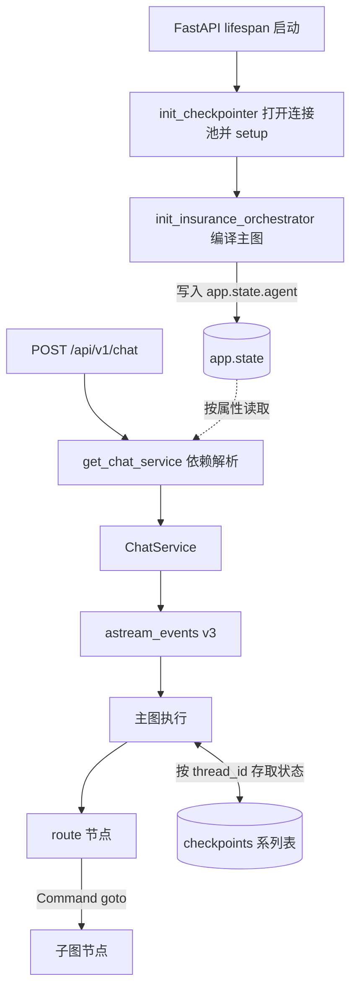
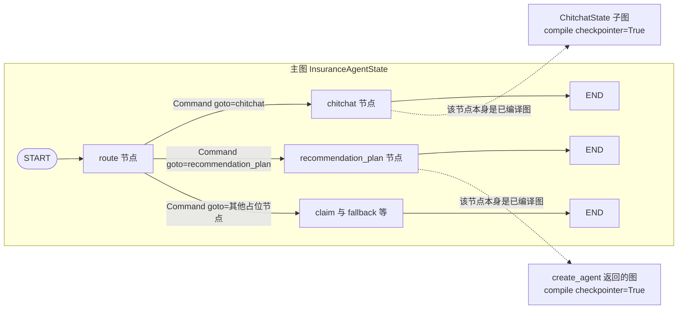
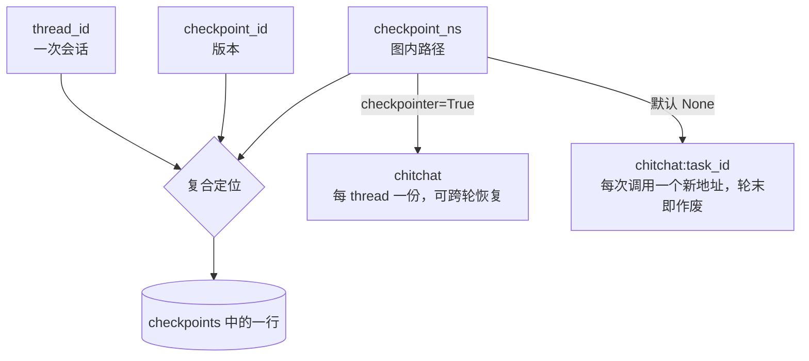

# 02 Agent 注入、子图嵌入与检查点命名空间

> 分析日期：2026-11-16
> 目标：整理本次围绕 `chat/router.py`、`agents/orchestrator.py` 提出的五个疑问及对应解答：请求里如何取得 Agent、子图如何嵌入父图、`checkpointer=True` 的作用、推荐的子 Agent 为何也要 `True`、`checkpoint_ns` 是什么。
> 实现边界：项目事实来自当前工作区代码；机制细节来自本地已安装依赖源码，版本见下文；文中标注「示意」的内容不代表数据库或运行时的真实记录。**本次没有启动服务、没有连接数据库、没有实际发送对话请求**，涉及运行结果的结论均为按源码推断，需后续实测确认。

## 1. 本文要回答的五个问题

| 编号 | 问题 | 结论状态 |
| --- | --- | --- |
| Q1 | `get_chat_service` 里的 `request.app.state.agent` 从哪来，对应的 Agent 是哪一个？ | 已核对项目代码 |
| Q2 | `orchestrator.py` 中子图如何嵌入父图？ | 已核对项目代码与依赖源码 |
| Q3 | 为什么闲聊子图必须 `checkpointer=True`？ | 已核对依赖源码；实验未执行 |
| Q4 | 推荐的子 Agent 并没有 `chitchat_count` 这类字段，为什么也要 `True`？ | 已核对依赖源码；必要性为推断，未实测 |
| Q5 | `ns` 是什么意思？ | 已核对依赖源码 |

## 2. 阅读范围与证据

| 依赖 | 当前版本 |
| --- | --- |
| `langgraph` | `1.2.21` |
| `langgraph-checkpoint` | `4.3.1` |
| `langgraph-checkpoint-postgres` | `3.2.0` |
| `langchain` | `1.5.0` |
| `langchain-protocol` | 由 `langgraph` 引入，v3 流式事件协议定义在此 |
| `fastapi` | `>=0.139.2` |

证据分三类：**项目事实**来自仓库代码；**库实现**来自本地已安装版本的源码；**示意**用于理解关系，不代表真实运行数据。升级依赖后应重新核对。

项目入口：

- [启动与关闭](../../agent-service/app/main.py)：`lifespan()`、`app.state.agent`。
- [检查点初始化](../../agent-service/app/infra/checkpointer.py)：`init_checkpointer()`。
- [聊天路由](../../agent-service/app/modules/chat/router.py)：`get_chat_service()`。
- [聊天服务](../../agent-service/app/modules/chat/service.py)：`ChatService`、`chat_stream()`。
- [主图](../../agent-service/app/agents/orchestrator.py)：`init_insurance_orchestrator()`、`route_node()`。
- [闲聊子图](../../agent-service/app/agents/chitchat.py)：`ChitchatAgent.build()`。
- [推荐子 Agent](../../agent-service/app/agents/insurance_advisor.py)：`init_insurance_advisor()`。
- [意图与状态定义](../../agent-service/app/agents/schemas.py)：`Intent`、`InsuranceAgentState`。

本地库实现（Windows 虚拟环境路径）：

- `agent-service/.venv/Lib/site-packages/langgraph/pregel/main.py`：`_resolve_checkpointer()`、`_own_checkpoint_config()`、`get_state()` 的子图递归。
- `agent-service/.venv/Lib/site-packages/langgraph/pregel/_algo.py`：`checkpoint_ns` 拼接、`task_id` 计算、向子图出借 checkpointer。
- `agent-service/.venv/Lib/site-packages/langgraph/pregel/_loop.py`：输入如何叠加到已恢复的通道上。
- `agent-service/.venv/Lib/site-packages/langgraph/types.py`：`Checkpointer` 三种取值的语义。
- `agent-service/.venv/Lib/site-packages/langgraph/graph/state.py`：`StateGraph.compile()` 的参数说明。
- `agent-service/.venv/Lib/site-packages/langgraph/checkpoint/postgres/base.py`：库表主键与命名空间注释。
- `agent-service/.venv/Lib/site-packages/langgraph/_internal/_constants.py`、`_config.py`：命名空间分隔符与规范化。
- `agent-service/.venv/Lib/site-packages/langchain/agents/factory.py`：`create_agent()` 如何转交 `checkpointer`。
- `agent-service/.venv/Lib/site-packages/langchain/agents/middleware/types.py`：`AgentState` 字段。
- `agent-service/.venv/Lib/site-packages/langgraph/stream/transformers.py`、`langchain_protocol/protocol.py`：v3 `messages` 事件形状。

## 3. Q1：`get_chat_service` 里的 Agent 从哪来

### 3.1 读取链路只是属性访问

[router.py](../../agent-service/app/modules/chat/router.py) 中：

```python
def get_chat_service(
    session: Annotated[AsyncSession, Depends(get_session)], request: Request
) -> ChatService:
    agent = request.app.state.agent
    return ChatService(session, agent)
```

`request` 是 Starlette 的 `Request`，`request.app` 返回当前 FastAPI 实例；`app.state` 是挂在 app 上的 `State` 对象，本质是一个字典式命名空间。因此这一行**只是按属性名取一个对象**，不涉及依赖解析、不做拷贝、不需要每次重构。

### 3.2 写入发生在 lifespan 启动阶段

[main.py](../../agent-service/app/main.py) 的执行顺序：

1. `check_database()` 检查业务数据库连通性。
2. `await init_checkpointer()` 打开 psycopg 连接池并执行 `saver.setup()`。
3. `app.state.agent = init_insurance_orchestrator(checkpointer)`。
4. `yield`，开始对外服务。

顺序要点：saver 必须先就绪，才能交给图去 `compile`。因此第一个请求到达时该属性必然存在。

同一段代码里第 43 行还留着被注释的 `app.state.agent = init_insurance_agent(checkpointer)`，那是接入 orchestrator 之前的旧入口。

### 3.3 它是主图编译产物，不是某个子 Agent

`init_insurance_orchestrator()` 返回 `builder.compile(checkpointer=checkpointer)` 的结果，类型是 `CompiledStateGraph`。这正是 [service.py](../../agent-service/app/modules/chat/service.py) 中 `ChatService.__init__(..., agent: CompiledStateGraph)` 的标注来源。

也就是说，`app.state.agent` 指向的是**主图**（`route` 节点加若干分支节点），不是 `chitchat` 或 `recommendation_plan` 这两个子图。

### 3.4 为什么进程级单例是安全的

编译后的图本身不携带会话数据，可变状态全部外置：

| 状态类型 | 存放位置 | 代码位置 |
| --- | --- | --- |
| 会话记忆（跨轮） | checkpointer，按 `thread_id` 区分 | `config={"configurable": {"thread_id": ...}}` |
| 请求级信息 | 运行时 `context`，不写入 state | `context=InsuranceAgentContext(user_id=...)` |

因此多个并发请求可以共用一张图，各自使用独立的 `thread_id`。

### 3.5 三个边界

- **强依赖 lifespan**。测试中若未进入 lifespan 上下文（例如 `AsyncClient(app=app)` 未配合 `async with`），该属性不存在，会直接抛 `AttributeError`。
- **不要在请求里重新 `compile`**。会重建图、失去既有 checkpoint 的连续性，并且每次都有额外开销。
- **多 worker 各自一份**。每个 uvicorn 进程都会执行一次 lifespan，各自编译一次；这不是跨进程共享对象。

### 3.6 可以改进的写法

`app.state` 是动态属性，IDE 与类型检查器无法校验。可抽出一个带类型标注的依赖：

```python
def get_agent(request: Request) -> CompiledStateGraph:
    agent = getattr(request.app.state, "agent", None)
    if agent is None:
        raise RuntimeError("Agent 未初始化：请确认 lifespan 已执行")
    return cast(CompiledStateGraph, agent)
```

这是改进建议，**当前代码未做此修改**。

### 图 1：请求到主图的依赖关系



## 4. Q2：子图怎么嵌进父图

### 4.1 唯一机制：`add_node` 接受一个已编译的图

LangGraph 允许把编译后的图当作节点注册：

```python
builder.add_node("chitchat", init_chitchat_agent())
```

对父图而言，这个子图就是**一个原子节点**，子图内部的循环（例如 agent 的模型—工具往返）完全封装在内部。

### 4.2 两个子图的形态对照

| 节点名 | 子图来源 | 子图形态 | 编译方式 |
| --- | --- | --- | --- |
| `chitchat` | `init_chitchat_agent()` | 手写 `StateGraph(ChitchatState)` | `compile(checkpointer=True)` |
| `recommendation_plan` | `init_insurance_advisor()` | `create_agent(...)` 返回的图（模型节点加工具节点） | `create_agent(checkpointer=True)` |

`create_agent` 并不特殊：它在结尾把 `checkpointer` 原样转交给 `graph.compile(checkpointer=checkpointer, ...)`。

### 4.3 必须对齐的四个契约

**① 节点名等于路由目标名。**
`route_node` 通过 `Command(goto=intent)` 动态跳转，`intent` 的类型是 `Intent`，取值来自 `schemas.py` 中的 `Literal`。节点名必须与 `add_node` 的第一个参数逐字相同，否则运行时报找不到节点。这是一处隐式耦合，适合加注释或抽成常量。

另有一处容易忽略：寒暄被规则命中时直接 `goto=END`，**不会进入 `chitchat` 子图**，但 `active_workflow` 仍被记为 `chitchat`。

**② 状态按通道名对齐，不按类型继承关系。**
- 入：父图把当前状态传给子图时，子图只读取自己 schema 中声明过的通道。
- 出：子图返回的字典里，只有与父 schema 同名的键会写回父状态，并且走父图的 reducer（`messages` 使用 `add_messages`，按消息 ID 去重追加）。
- 子图独有通道（例如 `chitchat_count`）不会进入父状态。

`ChitchatState` 继承 `InsuranceAgentState`，目的正是取得 `messages`、`previous_workflow`、`active_workflow` 这三个通道。

**③ `checkpointer=True` 决定子图私有状态能否跨轮。** 详见第 5 节。

**④ `context` 自动向下传递。**
`astream_events(..., context=InsuranceAgentContext(user_id=...))` 只需在父图传一次，子图通过 `context_schema=InsuranceAgentContext` 在节点内读取，不需要把 `user_id` 塞进 state。

### 4.4 流式事件里的父子层级

v3 事件中 `params["namespace"]` 是路径：父图为 `[]`，进入子图后形如 `["chitchat:<task_id>"]`。因此遍历事件流时可以同时看到父子两级的消息，需要区分来源时按该字段过滤。langgraph 也提供了 `SubgraphTransformer`、`SubgraphStatus` 用于获取子图运行状态。

### 图 2：子图作为父图节点



## 5. Q3：`checkpointer=True` 到底做什么

### 5.1 checkpointer 存的是什么

`checkpoints` 表每行大致为：

```text
(thread_id, checkpoint_ns, checkpoint_id) → channel_values
```

`channel_values` 是「那一刻各通道的值」的快照。所谓跨轮记住状态，本质是：**用 `(thread_id, checkpoint_ns)` 找到最新一行，把通道值装回内存。**

所以关键不是「存不存」，而是「下一轮能不能用同一个地址查到上一次存的那行」。

### 5.2 两个定位维度

| 维度 | 含义 | 本项目取值 |
| --- | --- | --- |
| `thread_id` | 一次会话 | `str(chat_threads.id)` |
| `checkpoint_ns` | 图内部的路径，区分「哪张图、哪个节点、第几次执行」 | 由运行时拼接，业务代码不手写 |

`checkpoint_ns` 的拼接规则（`_algo.py`）：

```python
checkpoint_ns      = f"{parent_ns}|{name}" if parent_ns else name
task_checkpoint_ns = f"{checkpoint_ns}:{task_id}"
```

`|` 是层级分隔符，`:` 是节点与任务的连接符。根图命名空间为空字符串。

上面代码为便于阅读，把原实现中的 `NS_SEP` / `NS_END` 常量写成了字面量 `"|"` 与 `":"`。

### 5.3 默认情况下该地址每轮都变

`task_id` 由「本轮父图的 checkpoint ID、step、节点名、触发器」共同计算（`_algo.py`）。父图每跑一轮就产生新的 checkpoint ID，因此 `task_id` 每轮都不同。

于是在不写 `True` 时，`chitchat` 子图的地址形如：

```text
turn1:  <thread_id> | chitchat:8f3a1c...
turn2:  <thread_id> | chitchat:c91d47...
turn3:  <thread_id> | chitchat:27be05...
```

每轮都是新地址。上一轮存进去的 `chitchat_count` 查不到，`state.get("chitchat_count", 0)` 永远返回 0。

**注意：这里仍然写库了**，只是写进一个下轮不会再访问的地址。因此「不传 checkpointer 就不做检查点」是错误理解。

### 5.4 `True` 只做一次字符串裁剪

`langgraph/pregel/main.py` 中的 `_own_checkpoint_config()`，文档字符串写明：

> A `checkpointer=True` subgraph keeps one history per thread, stored under its namespace with the task ids removed.

实现是把每一段中 `:` 之后的部分切掉：

```text
"chitchat:8f3a1c9e"  →  "chitchat"
```

于是地址变成：

```text
turn1:  <thread_id> | chitchat
turn2:  <thread_id> | chitchat
turn3:  <thread_id> | chitchat
```

第二轮进入子图时，先按该地址读回上一轮的通道值，**再把本轮输入叠加**（`_loop.py` 中通过 `apply_writes` 应用输入，属于叠加而非整体替换）。因此 `chitchat_count` 才能累加，而 `messages` 因为 `add_messages` 按 ID 去重，不会重复。

补充一个实现细节：该函数与 `recast_checkpoint_ns()` 并不完全等价，它**保留纯数字段**。源码注释说明原因：同一节点在一轮内多次调用同一个子图时，这些数字能让每次调用的历史分开存放。

### 5.5 saver 从哪来

`_resolve_checkpointer()` 的判定顺序：

```python
if self.checkpointer is False:
    return None                                  # 不落库
if CONFIG_KEY_CHECKPOINTER in config[CONF]:
    checkpointer = config[CONF][CONFIG_KEY_CHECKPOINTER]   # 父图出借
elif self.checkpointer is True:
    raise RuntimeError("checkpointer=True cannot be used for root graphs.")
else:
    checkpointer = self.checkpointer             # 自带实例
```

父图在准备任务时会把自己的 saver 放进子图的 config。因此：

- `True` 表示「**借用父图的 saver，但使用自己的命名空间**」，不会新建连接池
- 根图写 `True` 会直接报错，因为没有对象出借给它

这也解释了为什么这里只能写 `True`：saver 实例在 lifespan 中才创建，模块导入阶段拿不到；而传入真实实例会让 `_own_checkpoint_config()` 提前返回，命名空间又回到带 `task_id` 的形态。

### 5.6 三种取值对照

`langgraph/types.py` 中的定义：

| 取值 | saver 来源 | 命名空间 | 私有通道能否跨轮 |
| --- | --- | --- | --- |
| `None`（不传） | 也可借用父图的 | `节点名:task_id` | 不能，每轮重置 |
| `True` | 借用父图的 | `节点名` | 能，每个 thread 一份 |
| `False` | 不使用 | 无 | 不能，完全不落库 |

**`None` 与 `True` 的唯一差别就是命名空间里有没有 `task_id`。**

### 5.7 用闲聊子图走一遍

`MAX_CHITCHAT_COUNT = 3`，第 4 次才返回固定回复。

| 轮次 | 子图读到的 `chitchat_count` | 返回 | 写入位置 |
| --- | --- | --- | --- |
| turn 1 | 缺省 0，且上一轮不是闲聊，重置为 0 | 正常闲聊 | `(thread, "chitchat")`，`chitchat_count=1` |
| turn 2 | 恢复出 1 | 正常闲聊 | `chitchat_count=2` |
| turn 3 | 恢复出 2 | 正常闲聊 | `chitchat_count=3` |
| turn 4 | 恢复出 3，满足 `>= 3` | 固定回复 | 不再自增 |

若把 `True` 改成 `compile()`，turn 2 起读到的都是空，计数永远为 0，`MAX_CHITCHAT_COUNT` 会成为不会生效的常量。因此对 `chitchat` 而言 `True` 是功能前提，不是可选优化。

需要注意，即使计数被恢复，`previous_workflow != "chitchat"` 时仍会清零；这一业务层重置逻辑与 checkpointer 的持久化是互补关系，不能互相替代。

### 图 3：两种命名空间与同一个 thread



## 6. Q4：为什么推荐的子 Agent 也要 `True`

### 6.1 机制相同，问题要换个问法

`create_agent(checkpointer=True)` 只是把值转交给 `graph.compile()`，语义与 `compile(checkpointer=True)` 完全一致。因此真正的问题是：

> 这个子图的 schema 里，有没有「父图看不见、又需要跨轮存活」的通道，或者 `interrupt()` 断点？

有则需要，没有则可以省略。

### 6.2 该子图当前的私有状态其实很少

`create_agent` 默认 state 为 `AgentState`：

```python
class AgentState(TypedDict, Generic[ResponseT]):
    messages: Annotated[list[AnyMessage], add_messages]
    jump_to: NotRequired[Annotated[JumpTo | None, EphemeralValue, PrivateStateAttr]]
    structured_response: NotRequired[Annotated[ResponseT, OmitFromInput]]
```

- `jump_to` 是 `EphemeralValue`，每个 superstep 结束即清空，本就不需要跨轮
- `structured_response` 仅在配置 `response_format` 时有值，本项目未使用
- 其余信息都在 `messages` 中，而 `messages` 属于父图通道，由父图的 checkpointer 负责跨轮

**据此推断：按当前代码，推荐子图去掉 `True` 后基础对话流程仍应可用。这一点本次未实测。**

这与 `chitchat` 不同：`chitchat_count` 是父图 schema 里根本不存在的键。

### 6.3 保留 `True` 的三个理由

**① 为「方案确认」的 `interrupt()` 铺路。**
系统提示要求「与用户确认后，调用工具保存方案」。当前这个确认依赖模型在对话中追问、用户在下一轮回复。但保存方案会写业务库，属于有副作用的操作，后续更稳妥的实现是在工具前加 `interrupt()` 或人工确认中间件。一旦引入中断，子图必须在暂停的那一步被精确恢复，而恢复依赖 `(thread_id, checkpoint_ns)` 定位断点；命名空间中含每轮变化的 `task_id` 时就找不到断点。此时 `True` 从可选变成必需。

**② 中间件会往 agent 自己的 state 里写东西。**
若后续加入摘要、待办、自定义 `state_schema` 等中间件，这些变量不在父图 schema 中，父图无法持久化，只能依赖子图自己的命名空间。没有 `True` 时每轮重置，摘要会反复重算。

**③ 保持约定一致。**
统一规则「有状态的子图一律 `True`，纯函数式子图才省略」，比每次判断「这个子图现在有没有私有状态」更可靠。判断错误的后果是静默失效（数值永远是 0、摘要永远重算），不会报错。

### 6.4 需要知道的代价

| 代价 | 说明 |
| --- | --- |
| 存储放大 | 父子各存一份 `messages` 快照，一个 thread 每轮多写若干份完整历史 |
| 与父图裁剪冲突 | 子图恢复出的旧消息会被 `add_messages` 按 ID 并回，若在父图做过上下文裁剪，可能被重新加回 |

第二条的原因：子图的 `messages` 是先按自己的命名空间恢复、再叠加父图输入，`add_messages` 做的是按 ID 的并集。因此在父图替换 `messages` 列表后，子图侧恢复出的旧消息会重新出现。裁剪要么在子图内做，要么父子都做。

### 6.5 判断标准

| 子图 | 父图 Schema 之外的私有通道 | `True` 的必要性 |
| --- | --- | --- |
| `chitchat` | `chitchat_count` | 硬需求，去掉则计数逻辑失效 |
| `recommendation_plan` | 当前为空，但 `jump_to`、未来的中间件 state 与 `interrupt` 断点都在子图侧 | 预留，属于正确默认；引入中断后成为必需 |

## 7. Q5：`ns` 是什么

### 7.1 名字与出处

`ns` 是 **namespace（命名空间）** 的缩写。代码中出现三处：

- `checkpoint_ns`：变量名，也是数据库列名
- `CONFIG_KEY_CHECKPOINT_NS`：config 中的键
- `NS_SEP` / `NS_END`：拼接用的分隔符，分别为 `"|"` 与 `":"`

### 7.2 它是数据库主键的一列

`checkpoints` 表的定义：

```sql
CREATE TABLE checkpoints (
    thread_id     TEXT NOT NULL,
    checkpoint_ns TEXT NOT NULL DEFAULT '',
    checkpoint_id TEXT NOT NULL,
    ...
    PRIMARY KEY (thread_id, checkpoint_ns, checkpoint_id)
);
```

`checkpoint_blobs` 的主键为 `(thread_id, checkpoint_ns, channel, version)`，`checkpoint_writes` 的主键为 `(thread_id, checkpoint_ns, checkpoint_id, task_id, idx)`。

因此「命名空间不同」的准确含义是：**同表中的另一条记录，两份状态互不可见**。

### 7.3 格式

```text
根图                    ""
父图中一次子图调用       chitchat:8f3a1c9e...
子图内部再嵌一层         chitchat:8f3a1c9e...|handle_chitchat:5b2e...
```

### 7.4 为什么需要第二维

`thread_id` 只回答「哪一次会话」。但一次会话里存在多个互相独立的状态空间：主图一份、`chitchat` 一份、`recommendation_plan` 一份、子图内每个节点任务又各一份。这些都在同一个 thread 下，但谁也不能覆盖谁，所以需要第二维来区分。

可以用文件柜类比：

| 概念 | 类比 |
| --- | --- |
| `thread_id` | 一个抽屉（一次会话） |
| `checkpoint_ns` | 抽屉里的路径（哪张图、哪个节点、第几次执行） |
| `checkpoint_id` | 路径下的版本号（每个 superstep 一个新版本） |

### 7.5 本项目中的示意记录

假设 `thread_id = chat_thread_100`：

| thread_id | checkpoint_ns | 存了什么 |
| --- | --- | --- |
| chat_thread_100 | `""` | 主图：`messages`、`active_workflow`、`previous_workflow` |
| chat_thread_100 | `chitchat` | 闲聊子图私有状态，含 `chitchat_count` |
| chat_thread_100 | `recommendation_plan` | 推荐子 Agent 自己的 `messages` 快照 |
| chat_thread_100 | `chitchat:8f3a1c9e` | 某一次调用的临时记录，不写 `True` 时即为这种形态 |

以上为示意值，不是真实数据。

### 7.6 库源码中的一句注释最能说明问题

`langgraph/checkpoint/postgres/base.py` 在实现清理逻辑时的注释：

> A subgraph call's namespace has its task ID after a `:`, unlike a `checkpointer=True` subgraph's, whose state outlives each call.

含义是：带 `:` 的命名空间代表一次「调用」，会随根状态一起被回收；`checkpointer=True` 的子图命名空间不带 `:`，它的状态能活过每一次调用。

这正是 `True` 的最终解释：它改变的不是「存不存」，而是**这一列里有没有那段 `:task_id`**，从而决定这行状态是「一次调用的临时记录」还是「跨轮的持久状态」。

### 7.7 什么时候会直接接触它

平时由运行时自动维护，业务代码只传 `thread_id`。需要认识它的场景：

1. **按命名空间读取子图状态**：`get_state(config)` 需在 `configurable` 中指定 `checkpoint_ns`，`get_state(recurse=True)` 内部就是靠它递归取子图状态。
2. **`get_subgraphs()`**：先通过 `recast_checkpoint_ns()` 去掉任务 ID 再遍历。
3. **流式事件的 `params["namespace"]`**：同一路径的列表形式，父图为 `[]`，子图为 `["chitchat:8f3a1c9e"]`。

注意 `recast_checkpoint_ns()` 会同时丢弃纯数字段，而 `_own_checkpoint_config()` 保留纯数字段，两者用途不同，不要混用理解。

### 7.8 `task_id` 不是随机 UUID

它由「本轮父图 checkpoint ID、step、节点名、触发器」共同计算。因此：

- **同一轮内稳定**：中断恢复、重放、`get_state` 才能定位到同一位置
- **跨轮必变**：父图每轮产生新的 checkpoint ID

这就是「不写 `True` 时子图每轮地址都不同」的原因——不是随机，而是每轮确实是新的一轮。

## 8. 附带发现：`chat_stream` 的 v3 事件解析与协议不一致

这一条不属于上述五个问题，但与「子图输出能否到达前端」直接相关，一并记录。

### 8.1 当前实现

[service.py](../../agent-service/app/modules/chat/service.py) 中的文本提取：

```python
data = event["params"]["data"][0]
if isinstance(data, AIMessage):
    yield ServerSentEvent(data=data.text, event="message")
elif data.get("delta") and data["delta"].get("text"):
    yield ServerSentEvent(data=data["delta"].get("text"), event="message")
```

### 8.2 v3 中 `messages` 事件的真实形状

`params["data"]` 是一个 `(payload, metadata)` 二元组。库内 `MessagesTransformer` 会分别处理两种 `payload`：

1. 协议事件字典，带 `"event"` 键
2. 一条完整的 `BaseMessage`（且不是 `AIMessageChunk`、不是 `ToolMessage`）

其余形态（例如 `AIMessageChunk`、`ToolMessage`）会被该 projection 忽略，但仍可能出现在原始事件流里，因此读取侧需要自行判断类型。

协议字典是**内容块粒度**的，依次为 `message-start`、`content-block-start`、`content-block-delta`、`content-block-finish`、`message-finish`。文本增量位于 `content-block-delta` 中，形状为：

```python
{"event": "content-block-delta", "index": 0, "delta": {"type": "text-delta", "text": "..."}}
```

也就是说，**协议事件里没有顶层 `delta` 键**。当前 `elif` 分支取不到文本；若 `payload` 是非 `AIMessage` 的完整消息，`data.get(...)` 还会抛 `AttributeError`。

**推断结果：流式 token 很可能一条都不会输出，前端只会收到结束事件。** 本次未实际发送请求验证，需实测确认。

### 8.3 建议改法

```python
if method == "messages":
    payload, metadata = event["params"]["data"]
    ns = event["params"]["namespace"]
    if isinstance(payload, AIMessage):
        yield ServerSentEvent(data=payload.text, event="message")
    elif isinstance(payload, dict) and payload.get("event") == "content-block-delta":
        delta = payload.get("delta") or {}
        if delta.get("type") == "text-delta":
            yield ServerSentEvent(data=delta["text"], event="message")
```

其中 `ns` 可用于区分父子图来源。

### 8.4 复核方式

先把事件原样打印或落到调试日志，确认实际结构，再改解析逻辑。不要只依据类型定义推断。

## 9. 常见误解速查

| 误解 | 更准确的理解 |
| --- | --- |
| `app.state.agent` 是某个子 Agent | 它是 `init_insurance_orchestrator()` 返回的主图 |
| 每个请求都会重新创建 Agent | lifespan 只创建一次，请求仅读取属性 |
| `add_node` 只能传函数 | 也可以传一个已编译的图，此时它就是原子节点 |
| 子图继承父图 schema 就能共享全部状态 | 只有同名通道共享；子图独有通道不会写入父状态 |
| 不传 checkpointer 就不做检查点 | 默认仍会落库，只是地址带 `task_id`，下一轮读不回来 |
| `checkpointer=True` 会新建一个 saver | 它借用父图的 saver，只额外要求一个稳定命名空间 |
| 根图也可以写 `True` | 会直接抛错，因为没有对象出借 |
| `True` 能让模型记住对话 | 对话记忆来自父图 checkpoint 与 `thread_id` |
| `ns` 是对象或目录 | 它是字符串，并且是库表主键的一列 |
| `task_id` 是随机 UUID | 它由父图 checkpoint ID 等共同计算，同轮稳定、跨轮变化 |

## 10. 待确认与后续动作

- [ ] 用真实请求确认 v3 `messages` 事件的字段结构，据此修正 `chat_stream()` 的解析。
- [ ] 实测验证：把闲聊子图改为 `compile()` 后发送 4 轮闲聊，确认固定回复不再出现。
- [ ] 实测验证：把推荐子图改为 `compile()` 后确认基础对话是否照常，为第 6 节的推断取证。
- [ ] 评估存储增长：两个子图都开 `True` 时，单个 thread 每轮写入的 checkpoint 与 blob 数量。
- [ ] 若引入方案保存前的人工确认，需先确认子图的暂停与恢复路径。

## 11. 资料与核对依据

- 项目代码：[main.py](../../agent-service/app/main.py)、[checkpointer.py](../../agent-service/app/infra/checkpointer.py)、[chat/router.py](../../agent-service/app/modules/chat/router.py)、[chat/service.py](../../agent-service/app/modules/chat/service.py)、[orchestrator.py](../../agent-service/app/agents/orchestrator.py)、[chitchat.py](../../agent-service/app/agents/chitchat.py)、[insurance_advisor.py](../../agent-service/app/agents/insurance_advisor.py)、[schemas.py](../../agent-service/app/agents/schemas.py)、[tools.py](../../agent-service/app/agents/tools.py)。
- 本地依赖源码（版本以 `uv.lock` 记录为准）：`langgraph/pregel/main.py`、`_algo.py`、`_loop.py`、`langgraph/types.py`、`langgraph/graph/state.py`、`langgraph/checkpoint/postgres/base.py`、`langgraph/_internal/_constants.py`、`_config.py`、`langchain/agents/factory.py`、`langchain/agents/middleware/types.py`、`langgraph/stream/transformers.py`、`langchain_protocol/protocol.py`。
- [LangGraph 持久化概念文档](https://docs.langchain.com/oss/python/langgraph/persistence)：用于复核子图、命名空间与检查点的概念对应；实现细节以本地 `1.2.21` 为准，网页版本可能继续变化。
- [LangGraph 子图文档](https://docs.langchain.com/oss/python/langgraph/use-graph-api#subgraphs)：官方对「编译后的图作为节点」的说明；不等于本项目已经采用其全部模式。
- [langgraph 仓库](https://github.com/langchain-ai/langgraph)：可追踪 `_own_checkpoint_config` 等实现的历史变化。
- 同目录 [01-父子分块检索与保险条款问答](01-父子分块检索与保险条款问答.md)：本目录的格式与证据标注约定参照该篇。
