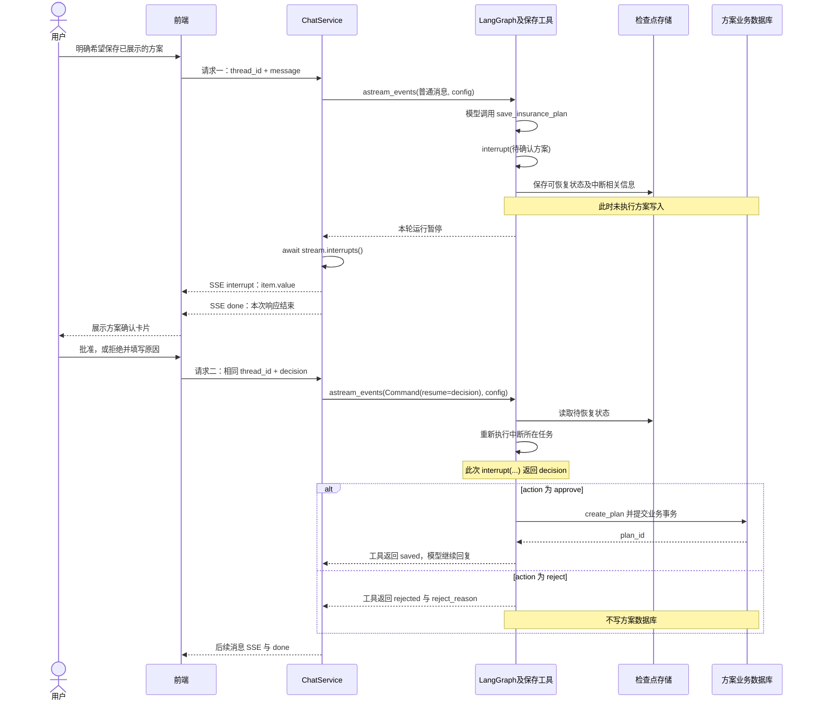
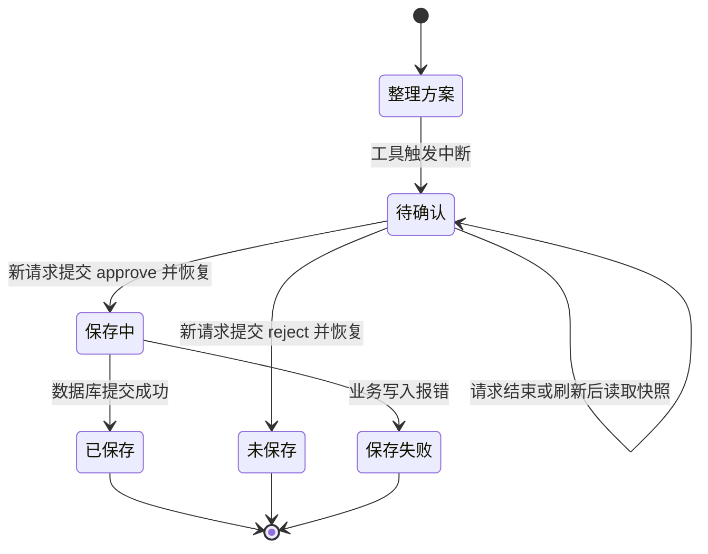
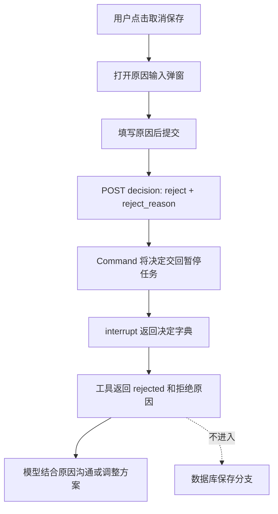
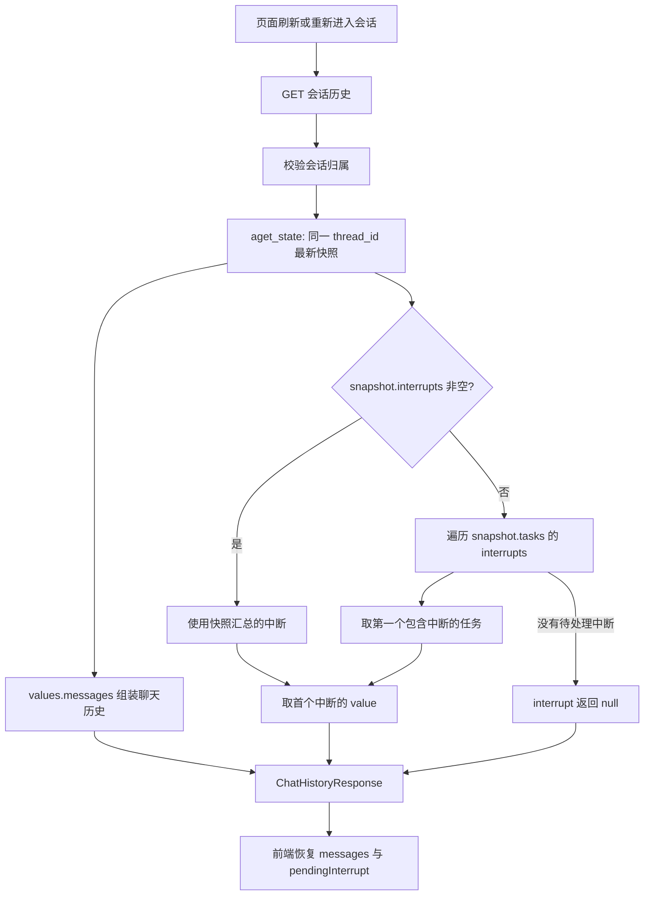

# 方案保存：中断、确认、恢复与历史回显

> 核对日期：2026-11-17。依据为当前工作区代码及本地依赖源码，包含尚未提交的改动。已运行内存检查点实验；没有启动项目服务、连接真实数据库或完成浏览器联调。图中的数据和 ID 为示意。

这个流程把一次“保存方案”拆成两次 HTTP 请求：第一次生成待确认方案，图暂停并返回确认内容；第二次携带用户决定，让同一会话的图继续执行。刷新页面时，还有第三条只读路径：从检查点恢复待确认卡片。

最关键的区别是：`interrupt(payload)` **提出问题并暂停**，`stream.interrupts()` **取出本次运行中暴露的问题**，`Command(resume=decision)` **提交答案**，`aget_state()` **读取当前尚未解决的问题**。它们不是四次中断。

## 1. 代码位置与职责

| 位置 | 负责什么 |
| --- | --- |
| [tools.py](../../agent-service/app/agents/tools.py)：`save_insurance_plan` | 构造确认内容；调用 `interrupt`；恢复后检查决定，批准才保存 |
| [chat/service.py](../../agent-service/app/modules/chat/service.py)：`chat_stream` | 区分普通输入与恢复输入；消费图事件；向前端发送中断 SSE |
| [chat/schemas.py](../../agent-service/app/modules/chat/schemas.py)：`ChatRequest` | 接收 `thread_id`、`message` 或 `decision` |
| [chat_thread/service.py](../../agent-service/app/modules/chat_thread/service.py)：`get_history` | 检查会话归属；读最新状态；返回历史消息与待处理确认 |
| [chat_thread/schemas.py](../../agent-service/app/modules/chat_thread/schemas.py) | `ChatHistoryResponse.interrupt` 承载待确认内容 |
| [checkpointer.py](../../agent-service/app/infra/checkpointer.py) | 初始化 `AsyncPostgresSaver`，提供可恢复的检查点存储 |
| [orchestrator.py](../../agent-service/app/agents/orchestrator.py)、[insurance_advisor.py](../../agent-service/app/agents/insurance_advisor.py) | 主图使用检查点；推荐子 Agent 包含保存工具 |
| [api.ts](../../frontend/src/api.ts) | POST 对话或恢复请求；解析 `interrupt` SSE |
| [AdvisorPage.tsx](../../frontend/src/AdvisorPage.tsx) | 显示确认卡片、收集批准/拒绝原因；历史加载时恢复卡片 |

## 2. 总体时序：一次业务，两次请求



检查点存储和方案表是两种职责。前者保存“图执行到哪里、哪些任务还待回答”；后者保存正式保险方案。项目可能把它们部署在同一 PostgreSQL 中，但**确认卡片已出现不代表方案表已插入记录**。

从业务状态看，HTTP 响应结束与方案保存完成也不是同一个状态：



图中的终点表示这次保存尝试结束，不表示整个聊天会话结束。

另有可打开查看的[中断确认机制示意图](配图/03-中断确认/interrupt-workflow.html)。该图说明通用控制机制；当前项目的具体入口、数据形状和验证范围以本文为准。

## 3. 工具中的 interrupt：第一次抛出，恢复时返回

当前工具的核心逻辑可压缩为：

```python
decision = interrupt({
    "plan": plan.model_dump(mode="json"),
    "confirm_info": "请确认是否保存当前保险方案?",
    "action": ["approve", "reject"],
})
# 此处只有恢复成功后才继续执行
if decision["action"] == "reject":
    return 拒绝结果
return await 保存方案()
```

这里有两份方向相反的数据：

| 数据 | 方向 | 示例 |
| --- | --- | --- |
| `interrupt(...)` 的参数 | 工具 → 用户 | 方案、确认文案、可选操作列表 |
| `interrupt(...)` 的返回值 `decision` | 用户 → 工具 | `{"action": "reject", "reject_reason": "预算太高"}` |

两者的 `action` 同名但含义不同：参数里的数组表示允许选择的选项；决定里的字符串表示用户本次选择。

第一次到达 `interrupt` 时，本地实现找不到恢复值，会抛出 LangGraph 自己处理的 `GraphInterrupt`。因此这一轮不会完成 `decision = ...` 赋值，后面的数据库代码也不会执行。这是一种正常的暂停控制信号，不是普通业务失败。

**恢复不是保留 Python 调用栈后从下一行直接接着跑。** LangGraph 重新执行中断所在节点/任务，工具函数会再次被调用；到相同顺序的 `interrupt` 时，框架取出恢复值并返回它，然后才执行后面的分支。已经完成的整张图不必全部从头执行；嵌套子图的父调用边界也可能参与重放，不能把中断前的代码当成只执行一次。

所以，应把数据库写入、扣款、发通知等副作用放在批准判断之后。当前保存工具的数据库操作就在这个位置。恢复和重试也不等于数据库“恰好执行一次”的保证，生产环境如需处理重复确认，还要考虑幂等性。

## 4. chat 中的 stream.interrupts() 在等什么

用户指出的代码：

```python
pending_interrupts = await stream.interrupts()
for item in pending_interrupts:
    yield ServerSentEvent(data=item.value, event="interrupt")
```

这里把原变量 `interrupt` 在示例中改名为 `pending_interrupts`，仅为避免与工具中的 `interrupt()` 函数混淆，项目代码本次不改动。

`stream` 是 v3 `astream_events()` 返回的异步运行流对象。当前代码先用 `async for event in stream` 消费模型文本及自定义事件，再调用这个方法。

本地 `AsyncGraphRunStream.interrupts()` 的实现先驱动本次运行直到终点，再返回它收集的中断对象列表；若运行报错，会抛出错误。**终点可以是正常结束，也可以是等待人工输入的暂停；它不会一直等待用户点击按钮。** 在当前先遍历完事件流的用法中，本轮已经到达终点，调用方法主要是在获取收集结果。

内部观察器从 `values` 协议事件的 `params.interrupts` 收集中断信息。用户看到的 `event="interrupt"` 则是 ChatService 自己定义并转发给前端的 SSE 事件名，两层协议不能混为一谈。

`item` 是带 `.id`、`.value` 等属性的中断对象。当前只向前端发送 `.value`，即方案确认内容，没有发送中断 ID。

```text
框架中断对象：Interrupt(id="示意ID", value={plan, confirm_info, action})
                         ↓ 只取 value
SSE：event: interrupt
     data: {"plan": {...}, "confirm_info": "...", "action": ["approve", "reject"]}
```

前端 `handleSseEvent` 解析该事件，调用 `onInterrupt` 设置 `pendingInterrupt`，随后显示 `PlanInterruptCard`。收到 `done` 表示这次网络响应结束；业务保存流程仍可能处于待确认状态。

## 5. Command(resume=...)：第二次请求如何找到暂停位置

```python
if request.decision:
    _input = Command(resume=request.decision)
else:
    _input = {"messages": [HumanMessage(content=request.message)]}

config = {"configurable": {"thread_id": str(request.thread_id)}}
context = InsuranceAgentContext(user_id=user_id)
```

两种输入表达不同操作：

| 输入 | 含义 | 是否由这段代码新增 HumanMessage |
| --- | --- | --- |
| `{"messages": [HumanMessage(...)]}` | 提交一次普通对话输入 | 是 |
| `Command(resume=decision)` | 给现有待处理中断一个恢复值 | 否 |

因此，把“同意”当普通消息发送，与提交 `decision` 不是同一种框架指令。当前前端点击确认或拒绝时走第二条路径。

示例请求一：

```json
{"thread_id": "同一个会话UUID", "message": "请保存刚才的方案"}
```

示例请求二：

```json
{
  "thread_id": "同一个会话UUID",
  "decision": {"action": "reject", "reject_reason": "预算太高，希望降低费用"}
}
```

这里的 UUID 字样是示意占位符，实际请求要使用有效 UUID。

`thread_id` 是检查点查询的会话定位条件；必须使用同一会话，不能指望新建线程找到旧线程的暂停任务。`context.user_id` 是业务运行上下文，保存工具用它决定方案归属；它不是中断答案，也不代替 `thread_id`。ChatService 先检查会话属于当前用户，再开始图执行。

检查点提供恢复所需的图状态、任务及中断相关信息。当前项目的主图使用 `AsyncPostgresSaver`，因此从设计上支持跨请求恢复；实际数据库部署的持久化效果仍需项目联调确认，不能用本文的内存实验替代。

## 6. 拒绝原因如何回到模型



前端已有文本框，并以去除空白后的原因是否为空控制提交按钮；当前界面最多输入 200 字。`submitDecision()` 发送 `reject_reason`。工具恢复后再次清理首尾空白，缺失原因时使用“用户未填写原因”作为兼容值，随后返回 `status="rejected"`。

拒绝原因随工具返回值进入模型的后续处理；提示词要求它调整方案或追问，而不是自动重试保存。**这不等于原因已经进入独立的业务审计表**：当前没有专门的拒绝原因入库操作。

前端还会临时追加“确认保存保险方案/取消保存保险方案”这条用户气泡；后端恢复输入没有同步追加 HumanMessage，所以不能仅凭这段前端逻辑承诺刷新后仍有同一条用户气泡。

## 7. 历史接口：刷新后为什么仍能看到确认卡片



`snapshot = await agent.aget_state(config)` 是读操作，读取当前线程的最新状态，不会因此调用保存工具或批准方案。也不需要先有那次旧 HTTP 请求对应的 `stream` 对象。

用户指出的代码分两级查找：

```python
interrupts = None
if hasattr(snapshot, "interrupts") and snapshot.interrupts:
    interrupts = snapshot.interrupts
elif hasattr(snapshot, "tasks") and snapshot.tasks:
    for task in snapshot.tasks:
        if hasattr(task, "interrupts") and task.interrupts:
            interrupts = task.interrupts
            break
```

1. `hasattr` 检查属性是否存在；后半段检查其是否非空。存在但为 `()` 时仍会走 `elif` 尝试任务级信息。
2. `snapshot.interrupts` 是快照层的汇总视图；`task.interrupts` 是具体执行任务上的中断信息。
3. 当前本地 LangGraph 在构造快照时，把任务的中断汇总成 `snapshot.interrupts`。所以在当前版本中通常直接走第一分支；后半段是防御性兜底，不是一次额外恢复，也不是对子图状态树做递归搜索。
4. `break` 表示找到一个有中断的任务就停止；最终 `interrupts[0].value if interrupts else None` 只返回第一个中断内容。

最新快照中的汇总中断代表仍待回答的中断；本地依赖注释另有说明：如果指定旧 checkpoint 或读状态历史，其中可能包含后来已经回答的中断。当前代码没有指定旧 checkpoint ID，目的是恢复当前待办。

前端加载历史后执行 `setPendingInterrupt(history.interrupt)`。因此，实时 SSE 和历史接口是同一张待确认卡片的两种数据来源：

| 路径 | 用途 | 数据来源 |
| --- | --- | --- |
| `stream.interrupts()` → SSE | 本次对话刚产生待确认时展示 | 本次运行收集结果 |
| `aget_state()` → 历史响应 | 刷新/切换会话后恢复待确认 | 持久化状态的最新快照 |

批准或拒绝被成功消费且图继续完成后，最新快照应不再显示该待处理中断；如果恢复失败，不能只因前端隐藏了卡片就认定后台已完成处理。

## 8. 本地实验证据与边界

核对环境：`langgraph 1.2.21`、`langchain 1.5.0`、`langchain-core 1.8.0`、`langgraph-checkpoint-postgres 3.2.0`。

构造一个只有确认节点的 `StateGraph`，用 `InMemorySaver` 保存状态，节点在 `interrupt()` 前后各增加一次计数。两次均使用 v3 事件流，先遍历事件，再读取 `stream.interrupts()`；随后读取 `aget_state()`。

| 观察项 | 首次执行后 | 使用 reject 决定恢复后 |
| --- | --- | --- |
| 中断前代码累计执行次数 | 1 | 2 |
| 中断后代码累计执行次数 | 0 | 1 |
| 本次 `stream.interrupts()` 长度 | 1 | 0 |
| 最新 `snapshot.interrupts` 长度 | 1 | 0 |
| 待执行任务的中断数量 | `[1]` | `[]` |
| `snapshot.next` | `("confirm",)` | `()` |
| 图状态中的决定 | 尚无 | `{"action":"reject","reject_reason":"预算太高"}` |

这些结果验证了重新执行、恢复值传递、实时中断与快照待办的关系。另有[保存工具回归测试](../../agent-service/tests/test_save_plan_confirmation.py)，使用真实图的 interrupt/resume、模拟数据库，覆盖批准、拒绝、原因清理和无效决定不写库。

本次实验没有验证真实模型如何选工具、真实 PostgreSQL 的检查点表内容、完整父子图的每个事件，以及业务页面里的网络和交互效果。机制示意图为 workflow 类型，其规范校验、导出、产物检查与浏览器自动检查均通过，未进行截图视觉审阅。详见[自动检查摘要](配图/03-中断确认/interrupt-workflow.finalize-summary.json)与[浏览器检查回执](配图/03-中断确认/interrupt-workflow.browser-check.json)；正文 Mermaid 可独立阅读。配图浏览器检查验证的是图形产物，不是保险业务页面。

## 9. 当前实现的限制及排查顺序

- **单个待确认的假设。** 实时路径可发多个中断，但前端只维护一个 `pendingInterrupt`，历史接口也只返回首个。并行审批时需要返回中断列表及 ID，并使用按 ID 定位的恢复值；现有非映射业务决定适用于当前单个待回答的设计。
- **输入选择依赖真值。** `if request.decision` 会把空字典当成普通消息。当前 `message` 和 `decision` 均可缺省，模型未要求二选一；实际 API 应考虑明确校验，避免空请求或歧义请求。
- **前端先清卡片再提交。** `submitDecision` 在请求前清空待办，失败时展示错误但不会在该分支自动重新读取快照。网络失败后的实际待办状态应以历史接口为准。
- **检查点不是保存事务的幂等锁。** 多标签页重复确认、确认时方案已过期、写库成功后响应丢失，均需要后续业务约束；本文不把当前单流程测试当作这些情况已解决的证据。

建议联调时按顺序检查：工具是否真的触发 `interrupt` → SSE 是否包含方案内容 → 前端是否收到并显示确认卡片 → 第二次请求是否带相同 `thread_id` 和 `decision` → 工具恢复后分支是否正确 → 正式方案是否仅在批准后保存 → 刷新时历史接口是否仍返回待处理卡片或正确清空。

## 10. 本地依赖依据

以下路径均相对于 `agent-service/.venv/lib/python3.14/site-packages/`，具体行号随安装版本变化：

- `langgraph/types.py`：`Interrupt`、`PregelTask`、`StateSnapshot` 与 `interrupt()`。恢复值匹配、首次抛出控制异常和重放规则在此定义。
- `langgraph/stream/run_stream.py`：`AsyncGraphRunStream._observe_event()` 与 `interrupts()`。前者收集当前命名空间的中断，后者驱动本次运行并返回列表。
- `langgraph/pregel/main.py`：异步快照构造逻辑把 `tasks_w_writes(...)` 的任务中断汇总成 `StateSnapshot.interrupts`。

本次只新增分析文档与配图材料，不修改上述业务流程。
