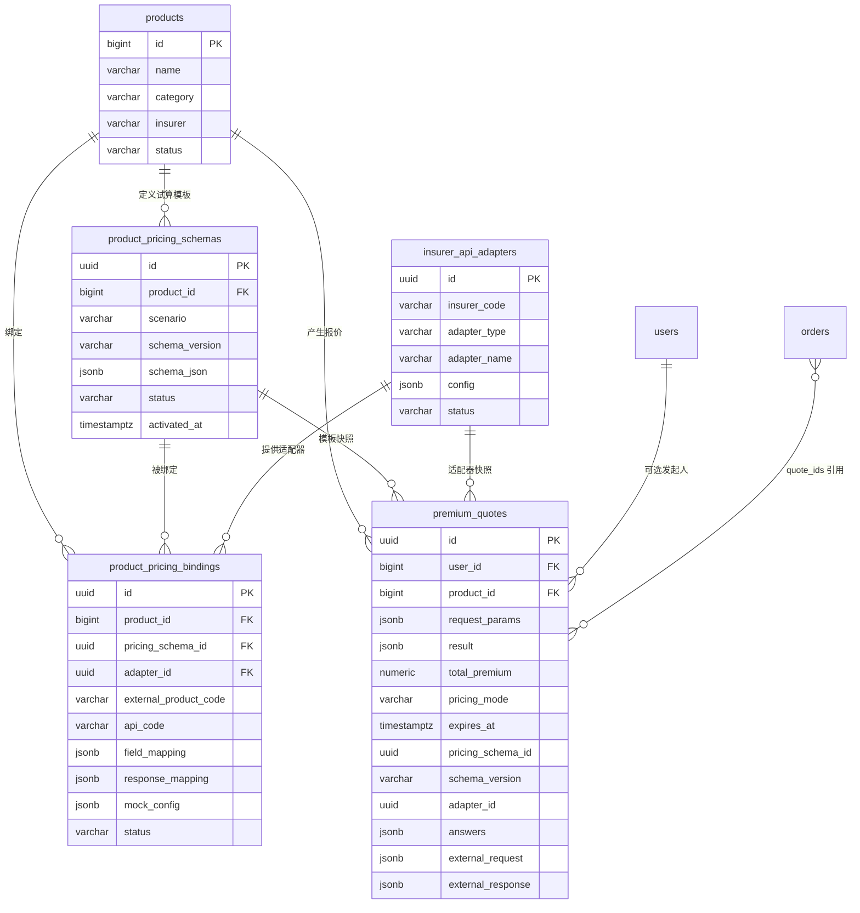
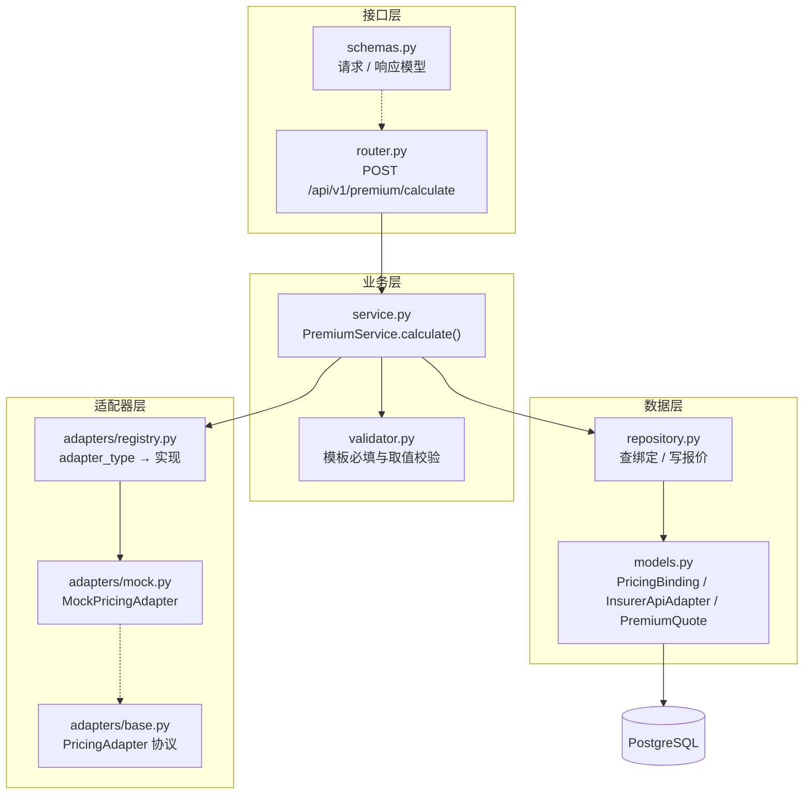
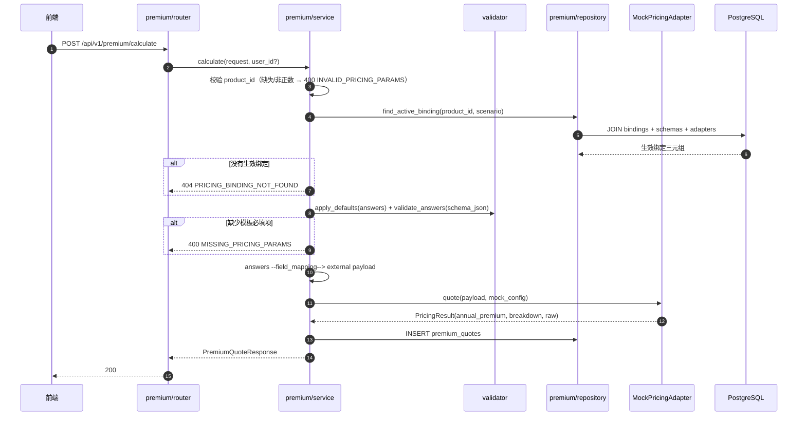

# 保费试算 Mock 适配器接口设计

本文对应 `POST /api/v1/premium/calculate`。目标是把「产品 → 试算模板 → 保险公司的 mock 适配器」串成一次可落库、可被下单引用的报价。

> 现状说明：数据库结构以 `deploy/postgres/init/01-init-biz-schema.sql` 为准（本机 PostgreSQL 未启动，未做在线核对）。业务代码目前只有 `GET /api/v1/products/{id}/pricing-schema`，`premium/calculate` 尚未实现。

## 1. 数据库现状

### 1.1 表关系



### 1.2 各表在这次接口中的职责

| 表 | 这次怎么用 |
| --- | --- |
| `products` | 只作为 `product_id` 的合法性来源；本接口不返回产品详情 |
| `product_pricing_schemas` | 提供 `schema_json.fields`，决定哪些参数必填、类型、可选值；同时确定 `scenario` 与版本 |
| `product_pricing_bindings` | 一次查询拿到「模板 + 适配器 + 字段映射 + mock 配置」，是接口的核心配置 |
| `insurer_api_adapters` | `adapter_type` 决定走哪个计价实现；`insurer_code` 出现在 `breakdown[].source.adapter` |
| `premium_quotes` | 每次试算落一条报价快照，`quote_id` 返回给前端，`orders.quote_ids` 后续引用 |
| `orders` | 本接口不写；下单时通过 `quote_ids` 引用报价并校验过期 |

`premium_quotes` 在 V6 迁移中新增了 `pricing_schema_id / schema_version / adapter_id / answers / external_request / external_response`，正好覆盖「模板版本 + 映射后请求 + 适配器原始响应」的追溯需求。

### 1.3 种子数据现状

| 产品 | 绑定适配器 | 计划编码（`mock_config.base_premium_by_plan`） |
| --- | --- | --- |
| 2 达尔文12号重疾 | `mock_fosun` | `basic` / `classic` / `premium` |
| 6 众安尊享e生 | `mock_zhongan` | `standard` / `plus` |
| 10 小蜜蜂6号意外 | `mock_cpci` | `basic` / `classic` / `premium` |

计价因子都放在 `mock_config` 里：

- `age_factor`：按年龄区间取系数
- `gender_factor` / `social_security_factor` / `occupation_factor` / `deductible_factor`：按枚举取值
- `coverage_unit` + `coverage_factor_enabled`：保额相对基准保额的倍率

> ⚠️ 接口文档示例使用 `product_id=2 + plan_code=standard`，但数据库里产品 2 的计划是 `basic/classic/premium`。示例只能当字段演示，实际校验和计价必须以数据库的 `plan_options`、`mock_config` 为准。

## 2. 代码结构图



### 2.1 文件清单

```text
agent-service/app/modules/premium/
├── __init__.py
├── router.py          # POST /api/v1/premium/calculate，依赖注入 + 可选登录
├── schemas.py         # PremiumCalculateRequest / PremiumQuoteResponse / BreakdownItem
├── service.py         # 编排：校验 → 查绑定 → 映射 → 计价 → 落库 → 返回
├── repository.py      # 三表 JOIN 查生效绑定；插入 premium_quotes
├── models.py          # product_pricing_bindings / insurer_api_adapters / premium_quotes
├── exceptions.py      # 400 / 404 三个业务异常
├── validator.py       # 默认值、必填、类型/选项/区间校验
└── adapters/
    ├── __init__.py
    ├── base.py        # PricingRequest / PricingResult / PricingAdapter 协议
    ├── mock.py        # 按 mock_config 计价
    └── registry.py    # adapter_type → adapter 实例
```

另外两处接线：

- `app/main.py`：`from app.modules.premium.router import router as premium_router` 并 `app.include_router(premium_router)`
- `app/modules/auth/dependencies.py`：新增 `get_optional_current_user`，请求头没有 Bearer 时返回 `None`，有则复用 `get_current_user`

## 3. 请求处理时序



## 4. 关键代码骨架

### 4.1 `schemas.py`

`product_id` 故意声明为可选：交给业务层抛 `400 INVALID_PRICING_PARAMS`，而不是被 FastAPI 的 422 校验拦截。

```python
from datetime import datetime
from typing import Any

from pydantic import BaseModel, Field


class PremiumCalculateRequest(BaseModel):
    product_id: int | None = None          # 缺失由 service 返回 400
    scenario: str = "premium_by_coverage"
    answers: dict[str, Any] = Field(default_factory=dict)


class BreakdownItem(BaseModel):
    item: str
    name: str
    premium: str
    source: dict[str, Any]


class PremiumQuoteResponse(BaseModel):
    quote_id: str
    product_id: int
    plan_code: str
    pricing_mode: str
    annual_premium: str
    payment_frequency: str
    breakdown: list[BreakdownItem]
    warnings: list[str]
    expires_at: datetime
```

> 保费统一用 `str` 输出（`"1234.56"`），避免 FastAPI 把 `Decimal` 编码成 float 丢精度。

### 4.2 `exceptions.py`

```python
from app.core.exceptions import ApplicationError


class InvalidPricingParamsError(ApplicationError):
    status_code = 400
    code = "INVALID_PRICING_PARAMS"
    message = "试算参数不合法"

    def __init__(self, message: str) -> None:
        super().__init__(message)
        self.message = message


class PricingBindingNotFoundError(ApplicationError):
    status_code = 404
    code = "PRICING_BINDING_NOT_FOUND"
    message = "产品没有生效中的试算绑定"


class MissingPricingParamsError(ApplicationError):
    status_code = 400
    code = "MISSING_PRICING_PARAMS"
    message = "缺少模板要求的试算参数"

    def __init__(self, fields: list[str]) -> None:
        super().__init__(fields)
        self.message = f"缺少试算参数：{', '.join(fields)}"
```

### 4.3 `models.py`

```python
class PricingBinding(Base, CreateAtMixin, UpdateAtMixin):
    __tablename__ = "product_pricing_bindings"

    id: Mapped[UUID] = mapped_column(PG_UUID(as_uuid=True), primary_key=True, default=uuid4)
    product_id: Mapped[int] = mapped_column(BigInteger, ForeignKey("products.id"))
    pricing_schema_id: Mapped[UUID] = mapped_column(
        PG_UUID(as_uuid=True), ForeignKey("product_pricing_schemas.id")
    )
    adapter_id: Mapped[UUID] = mapped_column(
        PG_UUID(as_uuid=True), ForeignKey("insurer_api_adapters.id")
    )
    external_product_code: Mapped[str] = mapped_column(String(120))
    api_code: Mapped[str] = mapped_column(String(120))
    field_mapping: Mapped[dict[str, Any]] = mapped_column(JSONB)
    response_mapping: Mapped[dict[str, Any]] = mapped_column(JSONB)
    mock_config: Mapped[dict[str, Any]] = mapped_column(JSONB)
    status: Mapped[str] = mapped_column(String(20), default="active")


class PremiumQuote(Base, CreateAtMixin):
    __tablename__ = "premium_quotes"

    id: Mapped[UUID] = mapped_column(PG_UUID(as_uuid=True), primary_key=True, default=uuid4)
    user_id: Mapped[int | None] = mapped_column(BigInteger, ForeignKey("users.id"))
    product_id: Mapped[int] = mapped_column(BigInteger, ForeignKey("products.id"))
    request_params: Mapped[dict[str, Any]] = mapped_column(JSONB)
    result: Mapped[dict[str, Any]] = mapped_column(JSONB)
    total_premium: Mapped[Decimal] = mapped_column(Numeric(14, 2))
    pricing_mode: Mapped[str] = mapped_column(String(30))
    expires_at: Mapped[datetime] = mapped_column(DateTime(timezone=True))
    pricing_schema_id: Mapped[UUID | None] = mapped_column(PG_UUID(as_uuid=True))
    schema_version: Mapped[str | None] = mapped_column(String(80))
    adapter_id: Mapped[UUID | None] = mapped_column(PG_UUID(as_uuid=True))
    answers: Mapped[dict[str, Any] | None] = mapped_column(JSONB)
    external_request: Mapped[dict[str, Any] | None] = mapped_column(JSONB)
    external_response: Mapped[dict[str, Any] | None] = mapped_column(JSONB)
```

模板模型复用 `app.modules.product.models.ProductPrice`（`product_pricing_schemas`），不在 premium 模块重复定义。

### 4.4 `repository.py`

一次 JOIN 拿全绑定上下文，避免 service 里三次查询：

```python
@dataclass(slots=True)
class PricingContext:
    binding: PricingBinding
    schema: ProductPrice
    adapter: InsurerApiAdapter


class PremiumRepository:
    def __init__(self, session: AsyncSession):
        self.session = session

    async def find_active_binding(
        self, product_id: int, scenario: str
    ) -> PricingContext | None:
        stmt = (
            select(PricingBinding, ProductPrice, InsurerApiAdapter)
            .join(ProductPrice, PricingBinding.pricing_schema_id == ProductPrice.id)
            .join(InsurerApiAdapter, PricingBinding.adapter_id == InsurerApiAdapter.id)
            .where(
                PricingBinding.product_id == product_id,
                PricingBinding.status == "active",
                ProductPrice.scenario == scenario,
                ProductPrice.status == "active",
                InsurerApiAdapter.status == "active",
            )
            .order_by(
                ProductPrice.activated_at.desc().nullslast(),
                ProductPrice.created_at.desc(),
            )
            .limit(1)
        )
        row = (await self.session.execute(stmt)).first()
        if row is None:
            return None
        binding, schema, adapter = row
        return PricingContext(binding=binding, schema=schema, adapter=adapter)

    async def add_quote(self, quote: PremiumQuote) -> None:
        self.session.add(quote)
```

### 4.5 `validator.py`

直接读 `schema_json` 的原始 dict，不依赖 `PriceSchema` 的字段模型（当前 `PriceSchema` 只保留了 `title/fields`，模板里的 `options/min/max/plan_options` 会丢）。

```python
def apply_defaults(answers: dict[str, Any], schema_json: dict[str, Any]) -> dict[str, Any]:
    merged = dict(answers)
    merged.setdefault("plan_code", "basic")
    return merged


def missing_required_fields(
    answers: dict[str, Any], schema_json: dict[str, Any]
) -> list[str]:
    missing = []
    for field in schema_json.get("fields", []):
        key = field.get("key")
        if not field.get("required") or not key:
            continue
        value = answers.get(key)
        if value is None or value == "":
            missing.append(key)
    return missing


def invalid_field_values(
    answers: dict[str, Any], schema_json: dict[str, Any]
) -> list[str]:
    errors: list[str] = []
    for field in schema_json.get("fields", []):
        key, value = field.get("key"), answers.get(field.get("key"))
        if not key or value in (None, ""):
            continue
        if field.get("type") == "integer" and not isinstance(value, int):
            errors.append(f"{key} 必须是整数")
        if (lo := field.get("min")) is not None and isinstance(value, int) and value < lo:
            errors.append(f"{key} 不能小于 {lo}")
        if (hi := field.get("max")) is not None and isinstance(value, int) and value > hi:
            errors.append(f"{key} 不能大于 {hi}")
    return errors
```

### 4.6 适配器

```python
# adapters/base.py
@dataclass(slots=True)
class PricingRequest:
    adapter_code: str
    external_product_code: str
    api_code: str
    payload: dict[str, Any]


@dataclass(slots=True)
class PricingResult:
    annual_premium: Decimal
    payment_frequency: str
    breakdown: list[dict[str, Any]]
    raw: dict[str, Any]


class PricingAdapter(Protocol):
    pricing_mode: str

    async def quote(
        self, request: PricingRequest, mock_config: dict[str, Any]
    ) -> PricingResult: ...
```

```python
# adapters/mock.py
class MockPricingAdapter:
    pricing_mode = "mock_adapter"

    async def quote(
        self, request: PricingRequest, mock_config: dict[str, Any]
    ) -> PricingResult:
        payload = request.payload
        plan_code = str(payload.get("packageCode") or "basic")

        base = mock_config.get("base_premium_by_plan", {}).get(plan_code)
        if base is None:
            raise InvalidPricingParamsError(f"不支持的计划编码：{plan_code}")

        factor = Decimal("1")
        factor *= _range_factor(mock_config.get("age_factor", []), int(payload.get("age") or 0))
        factor *= _map_factor(mock_config.get("gender_factor", {}), payload.get("gender"))
        factor *= _map_factor(mock_config.get("social_security_factor", {}), payload.get("hasSocialSecurity"))
        factor *= _map_factor(mock_config.get("occupation_factor", {}), payload.get("occupationClass"))
        factor *= _map_factor(mock_config.get("deductible_factor", {}), payload.get("deductible"))

        if mock_config.get("coverage_factor_enabled"):
            unit = Decimal(str(mock_config.get("coverage_unit") or 1))
            amount = Decimal(str(payload.get("sumInsured") or 0))
            if unit:
                factor *= amount / unit

        annual = (Decimal(str(base)) * factor).quantize(Decimal("0.01"), ROUND_HALF_UP)
        return PricingResult(
            annual_premium=annual,
            payment_frequency="annual",
            breakdown=[
                {
                    "item": "main",
                    "name": plan_code,
                    "premium": f"{annual:.2f}",
                    "source": {"adapter": request.adapter_code, "mode": "mock"},
                }
            ],
            raw={
                "base_premium": str(base),
                "factor": str(factor),
                "plan_code": plan_code,
                "payload": payload,
            },
        )
```

```python
def _range_factor(ranges: list[dict[str, Any]], age: int) -> Decimal:
    """年龄落在哪个区间，就取该区间系数；没有命中按 1.0。"""
    for item in ranges:
        if item["min"] <= age <= item["max"]:
            return Decimal(str(item["factor"]))
    return Decimal("1")


def _map_factor(mapping: dict[str, Any], value: Any) -> Decimal:
    """性别/社保/职业/免赔额这类枚举系数；没有配置按 1.0。"""
    if value is None:
        return Decimal("1")
    factor = mapping.get(str(value))
    return Decimal(str(factor)) if factor is not None else Decimal("1")
```

`registry.py` 只做 `{"mock": MockPricingAdapter}` 映射；将来接真实保司时新增 `http.py`，`pricing_mode = "insurer_api"`，service 不需要改。

### 4.7 `service.py`

```python
class PremiumService:
    QUOTE_TTL = timedelta(minutes=30)
    WARNINGS = [
        "本结果由教学 mock adapter 生成，不构成真实保险报价",
        "真实产品保费以保险公司试算接口和核保结果为准",
    ]

    def __init__(self, session: AsyncSession):
        self.session = session
        self.repository = PremiumRepository(session)

    async def calculate(
        self, request: PremiumCalculateRequest, user_id: int | None = None
    ) -> PremiumQuoteResponse:
        if request.product_id is None:
            raise InvalidPricingParamsError("product_id is required")
        if request.product_id <= 0:
            raise InvalidPricingParamsError("product_id must be a positive integer")

        # 读 + 写放在同一事务，避免 SELECT 自动开启事务后与 begin() 冲突
        async with self.session.begin():
            context = await self.repository.find_active_binding(
                request.product_id, request.scenario
            )
            if context is None:
                raise PricingBindingNotFoundError

            schema_json = context.schema.schema_json
            answers = apply_defaults(request.answers, schema_json)

            missing = missing_required_fields(answers, schema_json)
            if missing:
                raise MissingPricingParamsError(missing)

            errors = invalid_field_values(answers, schema_json)
            if errors:
                raise InvalidPricingParamsError("；".join(errors))

            payload = map_answers(answers, context.binding.field_mapping)
            adapter = get_adapter(context.adapter.adapter_type)
            result = await adapter.quote(
                PricingRequest(
                    adapter_code=context.adapter.insurer_code,
                    external_product_code=context.binding.external_product_code,
                    api_code=context.binding.api_code,
                    payload=payload,
                ),
                context.binding.mock_config,
            )

            quote_id = uuid4()
            expires_at = datetime.now(ZoneInfo("Asia/Shanghai")) + self.QUOTE_TTL
            response = PremiumQuoteResponse(
                quote_id=str(quote_id),
                product_id=request.product_id,
                plan_code=answers["plan_code"],
                pricing_mode=adapter.pricing_mode,
                annual_premium=f"{result.annual_premium:.2f}",
                payment_frequency=result.payment_frequency,
                breakdown=result.breakdown,
                warnings=self.WARNINGS,
                expires_at=expires_at,
            )

            await self.repository.add_quote(
                PremiumQuote(
                    id=quote_id,
                    user_id=user_id,
                    product_id=request.product_id,
                    request_params=request.model_dump(mode="json"),
                    answers=answers,
                    result=response.model_dump(mode="json"),
                    total_premium=result.annual_premium,
                    pricing_mode=adapter.pricing_mode,
                    expires_at=expires_at,
                    pricing_schema_id=context.schema.id,
                    schema_version=context.schema.schema_version,
                    adapter_id=context.adapter.id,
                    external_request={
                        "external_product_code": context.binding.external_product_code,
                        "api_code": context.binding.api_code,
                        "payload": payload,
                    },
                    external_response=result.raw,
                )
            )

        return response
```

字段映射：

```python
def map_answers(
    answers: dict[str, Any], field_mapping: dict[str, str]
) -> dict[str, Any]:
    return {
        external_key: answers[internal_key]
        for internal_key, external_key in field_mapping.items()
        if answers.get(internal_key) is not None
    }
```

### 4.8 `router.py`

```python
router = APIRouter(prefix="/api/v1/premium", tags=["保费试算接口"])


async def get_premium_service(
    session: Annotated[AsyncSession, Depends(get_session)],
) -> PremiumService:
    return PremiumService(session)


@router.post("/calculate", response_model=PremiumQuoteResponse)
async def calculate_premium(
    body: PremiumCalculateRequest,
    service: Annotated[PremiumService, Depends(get_premium_service)],
    user: OptionalCurrentUser,
) -> PremiumQuoteResponse:
    return await service.calculate(body, user.id if user else None)
```

`OptionalCurrentUser`：

```python
async def get_optional_current_user(request: Request) -> UserAuthData | None:
    scheme, _, token = request.headers.get("Authorization", "").partition(" ")
    if scheme.lower() != "bearer" or not token:
        return None
    return await get_current_user(request)


OptionalCurrentUser = Annotated[UserAuthData | None, Depends(get_optional_current_user)]
```

## 5. 落库字段对照

| 响应字段 | `premium_quotes` 列 | 说明 |
| --- | --- | --- |
| `quote_id` | `id` | `uuid4()`，同时返回给前端 |
| `product_id` | `product_id` | 请求原值 |
| `plan_code` | `answers.plan_code` | 默认 `basic` |
| `pricing_mode` | `pricing_mode` | mock 固定 `mock_adapter` |
| `annual_premium` | `total_premium` | `Decimal`，两位小数 |
| `breakdown` | `result.breakdown` | 统一响应快照 |
| `warnings` | `result.warnings` | 固定两条教学提示 |
| `expires_at` | `expires_at` | 默认 30 分钟 |
| 请求原文 | `request_params` | `product_id + scenario + answers` |
| 映射后请求 | `external_request` | 发给适配器的内容 |
| 适配器原始结果 | `external_response` | 便于排查 mock 系数 |

## 6. 错误码与边界

| 状态码 | 错误码 | 触发点 |
| --- | --- | --- |
| 400 | `INVALID_PRICING_PARAMS` | `product_id` 缺失/非正数；参数类型、区间、计划编码非法 |
| 404 | `PRICING_BINDING_NOT_FOUND` | 绑定/模板/适配器任一不是 active，或 scenario 不匹配 |
| 400 | `MISSING_PRICING_PARAMS` | 模板 `required=true` 的字段没填 |

其他边界：

- `answers` 的 key 是扁平点号字符串（`"insured.age"`），不是嵌套对象
- 同一产品可能有多个模板版本，取 `activated_at` 最新且 active 的一条
- 报价每次调用都新建，不按 `product_id` 去重；过期判断留给下单环节
- `expires_at` 建议统一时区（`Asia/Shanghai`）返回，与项目数据库连接时区一致

## 7. 测试清单

1. `product_id` 缺失 → 400 `INVALID_PRICING_PARAMS`
2. 产品无绑定 / 模板 inactive → 404 `PRICING_BINDING_NOT_FOUND`
3. 模板必填字段缺失 → 400 `MISSING_PRICING_PARAMS`，message 带字段名
4. 正常请求 → 200，`annual_premium` 是两位小数字符串，`breakdown[0].source.adapter == "mock_fosun"`
5. 计价算例：产品 2、`standard` 不在配置里 → 400；产品 2、`classic`、30 岁女、30 万保额 → `700 × 1.0 × 1.0 × 0.6 = 420.00`
6. 落库断言：`premium_quotes.pricing_mode == "mock_adapter"`，`schema_version`、`adapter_id`、`external_request` 均写入
7. 未登录可调用，`user_id` 为 `NULL`；带合法 Bearer 时写入用户 ID
